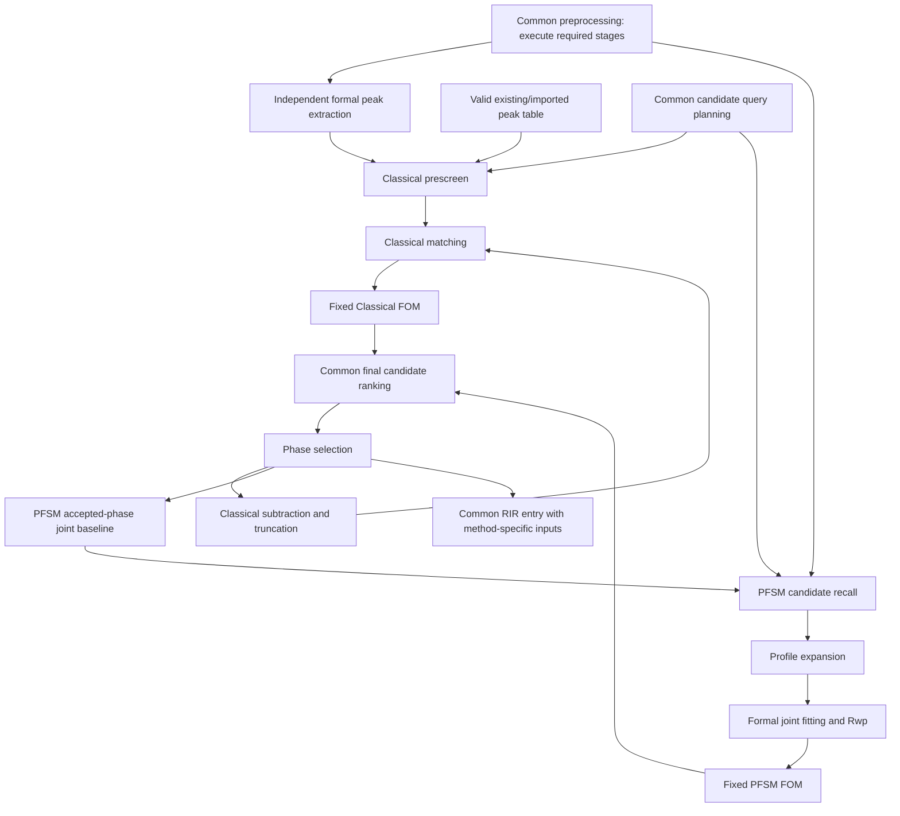
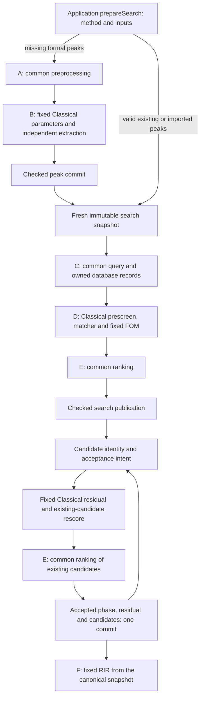

# Search-Match workflow and algorithm contracts

This guide describes the product workflow implemented from
`0f5b56eee139989d80df705c3a74e96bc4100bf7`. Core and Application remain Qt-free;
[Application ownership](overview.md) and the [numerical policy](../numerical/policy.md)
remain authoritative. The GUI separates Preprocessing, independent Peak Search,
and S&M menus. PFSM GUI execution uses the same owned worker and typed Application
requests as the synchronous search entry. Composition method buttons immediately
left of Min species and both menu commands share admission and checked method
transitions. FWHM estimation and existing formal peak extraction/CSM retain their own
routes. PFSM adds no QXP field, SQL schema or generic workflow engine.

## Workflow modules and ownership

Search-Match has three subworkflows and seventeen logical functional modules.
Their position describes ownership, not a requirement for seventeen interfaces.
Seven scientific replacement points remain; method-dependent operations and
common operations are concrete, fixed operations.

| Owner | Functional modules | Replacement points |
| --- | --- | --- |
| Common preprocessing | Background estimation, initial peak detection, physical FWHM estimation | All three |
| Independent peak extraction | Formal experimental peak extraction | Formal extraction |
| Classical SM | Candidate prescreen, peak-position/intensity matching, FOM, multiphase residual preparation | Matching only |
| PFSM | Candidate recall, profile expansion, formal profile fitting/Rwp, FOM, multiphase joint-baseline preparation | Expansion and fitting only |
| Common result operations | Database query planning, final candidate ranking, phase selection, RIR quantification | None |



The diagram expresses responsibilities, not unconditional execution. Existing
peak tables bypass formal extraction. PFSM uses fixed, compatible manual or
automatic geometric physical width without forcing the Classical initial-peak
chain. Classical parameter conversion remains distinct from physical FWHM.
Database query planning owns user constraints and read requirements; scientific
candidate prescreen/recall belongs to the selected method. A continuing PFSM
round recalls from the complete frozen unselected universe after joint baseline
stabilization; Classical continuation rescores existing candidates directly.

Recall priority is preliminary evidence, never final FOM or phase acceptance.
Formal PFSM fitting alone produces publishable candidate evidence. Its direct
final verification is not a global-optimum guarantee. Common ranking consumes
method-computed FOM: PFSM requests descending order for all formal results;
Classical retains the operation-specific ordering/capping table below. The RIR
entry consumes each method's scientifically valid scale/intensity inputs without
rerunning search or conflating their normalization conventions.

## Product flow and publication



| Route | Actual use cases | Commit point |
| --- | --- | --- |
| GUI automatic Match | `MainWindow::beginMatch` -> `prepareSearch` -> worker `PreprocessingEvaluation` -> fresh source -> `SearchTaskController` -> `SearchEngine::run` | Peak preparation publishes independently through `SearchCoordinator::complete`; search then publishes separately |
| CLI automatic Match | `ensurePeaksFound` -> `prepareSearch` -> `ProductPreprocessingEdit` -> fresh source -> `synchronousQuery` -> the same engine | Checked peak edit first; matching uses existing prepare-only search completion and prints the returned cards |
| Independent background/peak editors | Public stages inside private `PreprocessingEvaluation` | Existing source-bound editor commit or worker completion |
| Existing/imported peak table | `prepareSearch` validates real spectrum/range and measured table | No formal extraction; coordinate import still measures intensity/width from the real pattern and retains `imported` origin |
| Initial/scored browse | Fixed common query, Classical windows/prescreen, matching/FOM, common ranking | Existing coordinator transaction, or prepare-only caller contract |
| Rescore | Concrete Classical rescore over existing candidates, common ranking | One checked result publication; no database query or initial prescreen |
| Phase acceptance | `phaseAcceptanceInput` -> engine duplicate/scale checks -> fixed residual -> existing-candidate rescore | Accepted phase, residual history, peaks and candidates publish atomically |
| RIR/QXP | `quantifyProduct` -> sole `quantify_rir`; QXP consumes prepared percentages | Existing save-source checks and atomic writer; no result-state mirror |

`SearchEngine` remains the only synchronous product search executor. Its concrete
private `ClassicalWorkflow` supplies initial evaluation, rescore and residual
mathematics. Common result management receives method-computed scores; it does
not parse matching evidence or calculate FOM. Database/file/executor ports remain
architectural boundaries and are independent of scientific replacement points.

## Seven scientific replacement points

`AlgorithmSelections` and `AlgorithmModules` contain exactly seven fields: the
five Classical fields below plus `profile_expander` / `IProfileExpander` and
`profile_fitter` / `IProfileFitter`. The latter own immutable fixed-IL templates
and joint NNLS/TRF profile fitting respectively; see the [numerical contract](../numerical/pfsm.md).
`resolveAlgorithms` binds immutable identities/versions to owned implementations;
missing overrides use the other defaults. Wrong IDs, versions or match contracts
fail before scientific execution. A prepared task retains its source's exact handle.

| Field / interface | Input | Output / downstream consumption | Numerical owner |
| --- | --- | --- | --- |
| `background` / `IBackgroundEstimator` | Owned pattern, background options, wavelength and optional points | Background values/points and applied options; common processing validates alignment and consumes them | Core `legacy_background.cpp` |
| `initial_peaks` / `IInitialPeakFinder` (v5) | Checked unsubtracted spectrum/background, wavelength and owned `InitialPeakOptions` | Source-bound ordered derivative-trigger sample indices and actual detection parameters; no fitted widths, areas or `PeakSet` | Core `legacy_peaks.cpp` |
| `fwhm` / `IFwhmEstimator` | The same checked spectrum/background and initial candidates | Gaussian fitting, fixed width-dependent refinement, physical `FwhmEstimate` and initial-stage rejection diagnostics; fixed Classical mapping consumes the actual width | Core `legacy_peaks.cpp` |
| `experimental_peaks` / `IExperimentalPeakExtractor` | Checked spectrum/background and already prepared formal parameters | Formal peaks, candidate pool, actual parameters and automatic tolerance; measured fields and source identity are checked | Core `legacy_peaks.cpp` |
| `matcher` / `IClassicMatcher` | `ClassicMatchInput`: checked spectrum/background, range, valid peaks, reference card and parameters | `ClassicMatch` evidence; version/shape/index/numerical checks precede fixed Classical FOM | Core `classic_score.cpp` |

Candidate prescreen, quality checks, query planning, FOM, residual, ranking,
phase selection and RIR are fixed operations. Their former interfaces, identity
fields, overrides and factories are removed. A method cannot exchange its FOM
or residual policy independently of its matching semantics. This change leaves
one numerical implementation per calculation and retains its floating-point
translation unit/options.

## Preprocessing and width contracts

The independent `evaluateGeometricFwhm` Application API supplies a nonpublishing,
source-bound geometric width evaluation for future consumers. Its owned request
explicitly provides intensity, aligned background, masks/breaks and optional noise
or covariance. It does not use the Classical initial/FWHM replacement chain or
implicitly select a signal. The [geometric contract](../numerical/geometric-fwhm.md)
defines strongest-eligible selection, noise-unknown admission, diagnostics and
conditional uncertainty. Width evaluation does not dispatch PFSM or change default module selection
or add canonical/persisted state. The following contracts describe the unchanged
Classical path.

The public API is
[`preprocessing_workflows.h`](../../src/application/include/qualpf/application/preprocessing_workflows.h).
`evaluateCommonPreprocessing` returns a temporary `CommonPreprocessingResult`
bound to its opening source. It contains the working spectrum, a checked `AnalysisSpectrum`, background
information and optional initial/FWHM results; it contains no canonical search
candidates or accepted-phase state and performs no SQL, formal extraction,
acceptance or publication.

Public requests never replace observations with background-subtracted data.
`AnalysisSpectrum` owns an explicitly unsubtracted Pattern and its complete,
aligned background. Initial v5, Gaussian FWHM v3, formal extraction v3 and
Classical matching v2 consume this checked input. Each numerical adapter prepares
its own private signal, preserving the binary32 subtraction and the Classical
search clipping/normalization convention. Prepared net buffers cannot become
inputs of subsequent public stages. Smoothing keeps the working observations;
formal extraction and width preparation share the frozen raw/background input.
The retained `find_peaks` and direct scoring numerical APIs continue to exercise
independent frozen prepared-buffer references outside these product ports.

`InitialPeakResult` contains a dataset identity, strictly increasing full-pattern
sample indices and actual `PeakOptions`, including the resolved half-window.
An index denotes the original derivative trigger, before peak-top localization.
The finder performs normalization, SG differentiation and candidate triggering
only. The wavelength seed remains an initial detection parameter, never measured
width evidence. Application validates the source, indices and parameters before
invoking FWHM.

Initial v5 accepts explicit derivative threshold, automatic/manual half-window and
SG degree. Defaults preserve v3 numerical evaluation and the three-argument
convenience call. The effective SG degree remains `min(degree, 2 * half_window)`.
Application owns project-local configuration and standalone candidate evidence
with frozen source and checked spectrum/background. Independent evaluation uses
the same Classical Gaussian analysis preparation and performs neither width
fitting nor formal extraction. Managed workflow transactions also publish a
missing background after successful preparation. Gaussian preparation can reuse
exact compatible manual/same-flow candidates; it never reuses another flow's
automatic candidates merely because they exist. Fixed/geometric width paths do
not invoke initial detection. Configuration changes invalidate dependent results
through the [workflow settings contract](workflow-settings.md); unrelated
revisions retain them. Legacy explicitly constructed API states retain private
preparation and their existing invalidation behavior. QXP v1/v2 stores only the
version-1 `preprocessing.initial_peaks` configuration and opaque extensions.

`IFwhmEstimator::estimate(spectrum, initial, context)` consumes that same checked
spectrum/background. Its private numerical signal preserves the analysis convention. It reconstructs binary32 normalization without repeating SG or candidate
detection. The default implementation fits each trigger in the original trial
radius order, then retains the original duplicate/adjacency decisions, width-based
threshold, broad-peak fallback and historical previous-width reduction. Removal
mutations retain their original position in the calculation. It subsequently
measures baseline-corrected heights and raw trapezoidal areas, rejects coincident
baseline endpoints, applies height/cap filtering and stably selects the strongest
three usable measurements for the original binary32 mean. These compatibility
steps are fixed internal refinement, not a sixth replacement point. Formal peak
extraction shares these numerical functions and still owns its own local fitting.

`FwhmEstimationResult` contains the width evidence and initial-stage diagnostics;
`CommonPreprocessingResult::fwhm` returns this stage result. Parameter mapping and
canonical runtime state consume its `estimate` member. Diagnostics are merged
with formal diagnostics at the existing checked publication boundary. Raw initial
candidates remain temporary and are neither published as formal peaks nor saved.

`FwhmEstimate` uses `AngularWidthDegrees`, an explicit `measured` or
`no_initial_peaks` state, and a participating peak count. A measured zero is valid.
Missing/nonfinite/negative or inconsistent evidence fails. `no_initial_peaks` means
no usable measurements: raw triggers may exist but fail their fits or ordinary
filters. This preserves the original empty-result/fallback behavior. All candidates
rejected as unmeasurable is still an error. Wavelength fallback and `.9f` scaling
are never labelled as measured FWHM.

Fixed `prepare_classic_peak_parameters` maps options, FWHM and wavelength to
`PeakCalibration`. It preserves `mean * .9f`, the exact wavelength fallback and
manual skipping without new clipping. Half-window (samples), physical FWHM,
formal search range and matching tolerance (degrees two theta) remain distinct.

`evaluateFormalPeakExtraction` consumes an explicit analysis pattern and prepared
`PeakCalibration`. It performs no common initialization. Existing sliced detection,
full-spectrum normalization, minimum-peak retries, window adjustment, Gaussian
fitting, candidate pools, selection/append and automatic tolerance are preserved.
The tolerance remains `min(.5f, 1.3f * mean(final FWHM))`, or `.5` for an empty set.
`PreprocessingEvaluation` composes the stages once and validates their results
before its existing commit. An initial/FWHM failure invalidates a prior detection
cache so a failed preview cannot reselect stale candidates.

Built-in initial, FWHM and formal identities are versions 3, 2 and 2 respectively;
earlier versions of these contracts are explicitly unsupported. The endpoint
rejection behavior introduced with initial/formal version 2 is retained: coincident
local-baseline endpoints reject one candidate before division, with typed
stage/index/sample/angle/reason evidence. Initial diagnostics now originate in
FWHM refinement and keep the `initial` stage label. Their candidate index denotes
the original pre-measurement pool, not a raw-trigger list index. Only measurable
candidates feed width aggregation, the formal pool and selection. An entirely
unmeasurable detection fails atomically; other numerical errors retain their
existing contracts. Application validates module diagnostics against the full
input grid and keeps them in `PreprocessingConfiguration::rejected_candidates`
with the corresponding runtime candidate cache. Reselection preserves them;
changed pattern/peak inputs invalidate them. QXP has no added diagnostic field.
GUI previews show the skipped count and offer all candidate details while allowing
valid peaks to be applied. Automatic peak and Search preparation use the same rule.

[`prepareSearch`](../../src/application/include/qualpf/application/search_preparation.h)
returns `ready` or `needs_peak_preparation`, with a source-bound automatic request.
It performs method preflight first and never publishes. A valid nonempty imported
or existing table skips formal extraction, but Classical FOM still requires a real
continuous spectrum and calculation range. Missing inputs produce explicit errors;
no pseudo-spectrum is constructed. GUI owns asynchronous scheduling; CLI evaluates
the same request synchronously. Both fetch a new snapshot after the independent
peak commit. Later search cancellation/failure retains those committed peaks.

## Query, Classical calculation and ranking

Fixed `planCandidateQuery` owns user constraints/read requirements without a
Classical peak-table parameter. The Classical path alone prepares d/delta-d windows
and calls fixed `passes_stored_strongest` and `accepts_record_quality`. Stored
strongest values are the stored index sequence, never reconstructed reflections.
An absent preselected-ID list means not yet screened; a present empty list means
zero candidates. Density restraints intersect with every enabled restriction,
including zero hits. SQL NULL/deletion predicates and database row order remain
unchanged. Only initial/scored-browse operations read candidates; phase continuation
and rescore reuse the existing collection.

The matcher returns association evidence, not FOM. Fixed `calculate_classic_fom`
validates its declared contract, column shapes, indexes, association counts,
finite/order requirements and nonnegative evidence before calculation. Scientific
mixed precision, association windows/ties, interpolation, scale, reduction order
and structured failure behavior retain independent references. The continuous
pattern/range remains part of `ScoreInput` because the formula actually uses it.
Fixed residual processing retains inclusive windows, first-index ties, subtraction,
clipping, truncation, original intensity and the prior candidate scale.

Classical score validity and thresholds are evaluated before common ranking:

| Operation | Classical retention | Common `rankCandidates` |
| --- | --- | --- |
| Initial / CLI | `score > minimum` | Preserve input order at/below cap; only above cap stably sort descending and truncate |
| Rescore | `score > 0 && score >= minimum` | Always stable descending sort, cap; retain previous scale and its source |
| Scored browse | `score > threshold` (existing default browse threshold `-1`) | Preserve order, no cap |
| Metadata browse | Existing SQL metadata rules | Preserve order, no cap, no scientific score |

GUI column-header sorting only sorts the display model. It does not replace the
canonical snapshot, increment revision, reorder later equal-score results or
change QXP candidate order. `mergeCandidates` appends unique identities in request
order; `removeCandidates` removes identities without reordering survivors. Both
check source/thread and leave no-op state unchanged. `phaseAcceptanceInput` resolves
the canonical candidate and scale by ID; unscored/already accepted entries create
no acceptance intent. Batch acceptance retains explicit selected display-row order.
Confirmation remains GUI user intent; checked publication remains Application's
responsibility. Removing an accepted phase never restores previously subtracted
residuals.

Fixed `quantify_rir` preserves input order, binary64 multiplication/division and
ordered reduction. One invalid phase makes the whole result empty. It does not
clamp rounding: the existing valid `100 + 1 ULP` single-phase case remains saveable.
Widget and QXP prepare the same inputs from one immutable canonical snapshot and
call `quantifyProduct`; QXP serialization consumes those prepared percentages.

## Sources, invalidation and safety

Runtime `AlgorithmRunSource` / `CardAlgorithmSource` bind algorithms, frozen
parameters, weak source identity, source revision, task and database versions.
Sources are not a second state owner. QXP v3 preserves their stable algorithm and
parameter values, excluding task IDs and runtime weak pointers.

| Change or retained data | Rule |
| --- | --- |
| Background/initial/FWHM/formal implementation or defaults | Invalidate candidate pool, calibration/FWHM evidence and detected peaks; invalidate dependent candidates/scores; preserve imported/manual measurements under existing rules |
| Background change with unsubtracted working data | Drop derived background and manual background inputs under the existing invalidation rules |
| Method/matcher change | Invalidate candidate/accepted-phase scores; preserved old scales require compatible score producers before reuse |
| Historical residual | Retain history even after phase removal; require compatible method/matcher/preprocessing/defaults before continuation |
| Historical subtracted background | Require compatible estimator/options before reuse; restart from original signal to clear incompatible history |
| Same immutable specification | No-op; no new revision |
| Unknown QXP algorithm provenance | Read/display remains supported; scientific continuation requires explicit restart from original measurement |
| Non-default derived QXP source | Reject save before target replacement because QXP v1/v2 cannot attest it; switching back to defaults cannot launder retained origins |

Source/revision/task/database checks, cancellation, Busy/Closing, execution-thread
SQL, owned worker inputs, queued owner publication and safe close/drain remain in
`ProductSearchSession`, `SearchCoordinator` and the existing GUI task adapter.
Scientific errors and malformed successful payloads retire admission without
partial phase, residual or candidate publication. No forced termination or search
event pump is added.

All product requests carry an explicit `SearchMethod`. Method/source mismatches
fail before scientific execution. PFSM dispatch does not enter Classical peak
preparation, scoring or residual subtraction.

## PFSM continuous-profile workflow

PFSM candidate recall is enabled by default for new GUI analyses, with an explicit
disabled preference retained. The benchmark CLI and low-level requests still
default to off; shadow remains CLI-only. `PfsmProblem::candidate_recall` freezes
the mode, resource-limit policy and validated `PfsmCandidateRecallLimits` at analysis creation;
`PfsmRequest::full_round` overrides one run without changing that configuration.
Off uses the original full workflow and allocates no recall workspace. Shadow
records selections while formally fitting the entire pool. Enabled fits
only selected/tied/protected entries. Only built-in fixed IL and NNLS/TRF support
the approximation; replacements and small pools use the full path.

Only v2 grid/scan resource-limit errors dispatch to the `3fa1123a` bounded
integral/old-shift baseline by default. A project setting can instead request
full-pool formal fitting on those limits. The resource route follows the existing
off/full-round/small-pool/replacement priorities. Immutable integral cells follow
the frozen problem; old-phase banks and matched controls follow each baseline.
Integral success records its backend and switch reason separately from a full
fallback, and keeps the five-channel union without v2's review/formal caps.
The v2 formal-underestimation check never consumes integral diagnostics.

Every generation recalls from the complete immutable universe. The original
weighted correlation field persists with the frozen observations; the residual
field and joint local dictionary are rebuilt after baseline stabilization.
Workers own FFT/NNLS storage, preserve the caller's floating environment, and
join before checked publication. Scientific input errors and cancellation still
abort the transaction. Approximation failures protect individual cards or
explicitly fall back to full search. Approximate parameters never enter formal
scans, starts, budgets or published candidate evidence.

`PfsmCandidateRecallInput` owns the immutable problem/library handles, selected
phases, baseline, complete unselected indices and reusable recall data for one
joined operation. `PfsmCandidateRecallResult` returns the formal indices, recall
report, data and timings. Only the workflow merges these into its private analysis
draft. Recall never receives a mutable `PfsmAnalysis`.

The private `PfsmFormalCandidateInput` contains formal fit/expansion inputs,
identity, generation and shift bounds. `fitPfsmCandidate` receives only those
values, the formal modules and the immutable baseline. It performs the existing
H/4 scan, starts, checked joint fit and fixed `calculatePfsmFom` calculation.
`PfsmCandidateEvidence` is separate from recall diagnostics. The strict gate
rejects direct or transitive recall dependencies from the formal fitting and
expansion sources. Paired recall sampling is a Core-internal capability implemented
in the original expansion translation unit; formal template entry points are
unchanged.


If a screened candidate exposes a better zero-candidate baseline, the subset is
discarded and the complete pool replays from the screening-entry baseline. The
original two-rebuild limit remains. Discarded attempts remain labelled in the
round report. Only formally fitted cards are published, with normalization scope
explicitly distinguished between full pool and formal subset. The analytic
four-line local-alignment fixture exercises actual subset discard/full replay in
direct and cached modes, requiring identical full-pool fits and baseline curves.
Classical behavior and QXP persistence contracts are unchanged.

The Qt-free limits define recall target, initial/review shortlist, protection per
channel, review threshold and formal threshold (defaults 500/20/5/80/80). They
change selection and fallback only; ties and numerical protection remain included,
and exceeding either threshold triggers the full pool. State validation and
diagnostics use the frozen values. Default diagnostics retain their legacy names;
custom counts use number-independent reason names where the count changes.

GUI options use session values, then user preferences, then defaults under
`PFSMOptions/candidateRecall/`. Missing entries use defaults. Invalid count groups
recover to default counts with an inline warning without resetting other PFSM
settings; reading does not write back. Unknown fields survive explicit saves.
The two-tab dialog owns a private draft; only a validated OK commits it through
the checked Session transaction. Recalculation, acceptance and removal reuse the
immutable analysis configuration; a new analysis reads the new settings. The
dialog displays both the editable next-analysis settings and the current frozen
configuration. Relative FOM remains an immediate display filter and worker count
applies to the next run.

The current implementation is v2 only; the module is named `PfsmCandidateRecall`
without a version suffix. `--pfsm-candidate-recall` accepts off/shadow/enabled and
`--pfsm-candidate-recall-version` accepts v2. The CLI default remains off. Historical
`--fast-pfsm` and `--fast-pfsm-version` are aliases; an unspecified version now
means v2. Matching aliases are accepted, conflicts and explicit v1 requests fail
before execution. Reproduce v1 using its historical Git snapshot.

Reports add `candidate_recall`, `candidate_recall_mode`,
`candidate_recall_version` and `candidate_recall_*_seconds`; serialization emits
legacy `fast_pfsm`/`fast_*` aliases from the same values. Existing schema IDs and
`fast-N.jsonl` evidence filenames remain compatibility contracts. Current readers
accept either naming and reject contradictory aliases. Algorithm version v2 and
report format version 3 remain different concepts. Current validation tools use
`pfsm_candidate_recall_*`; old script names delegate through compatibility shims.

A new analysis supplies `PfsmRequest::observations`: the selected observed or
original signal, an explicit unclipped-signal declaration, units, noise source,
aligned background or common background estimation, and masks. Known standard
deviations yield inverse variances; declared raw counts yield `1/max(n,1)`;
counts/exposure yield the propagated rate variance. Unknown noise requires explicit
equal weighting. Correlated covariance is refused by this diagonal-weight model.
Working data with subtracted backgrounds/residual histories cannot masquerade as
original observations. Known scaled/relative intensities cannot be declared raw
Poisson counts; supplied variances must already use the observation units.
Selecting retained originals requires explicit `original_intensity_scaled` provenance
as well as their original radiation-processing state, rather than inheriting the
working spectrum's scaling flag. Radiation is explicit. `preparePfsmProblem` exposes full
Geometric FWHM provenance and rejection diagnostics, including no-eligible results.
No physical width fallback or Classical width conversion is used.

GUI preparation uses `makePfsmRequest` with independent `PFSMOptions/*` settings.
New GUI analyses select current unsubtracted working observations, including Range,
smoothing and Kalpha2 processing, with the existing aligned background. Missing
background uses common preparation with the current options and points. Frozen
problems retain the actual units, radiation and background points. Original noise
statistics are reused only for an unchanged original signal; transformed observations
without a defensible noise model explicitly use equal weights.
It requires runtime importer evidence for the measurement; legacy QXP arrays
alone require reimport. `ImportedPattern` carries that evidence through the
Application import boundary into `ProductState::original_signal_provenance`;
the frozen Core Pattern and numerical parser contracts are unchanged. Auto weighting uses explicitly sourced standard deviations
or raw-count declarations, otherwise explicitly records equal weights. A user can
also select equal weights. Width priority is explicit fixed configuration, a current
manual Gaussian/geometric measurement compatible with the unchanged input and
processing history, then automatic geometric estimation with configured Q (default
6). `PfsmProblem::physical_width` carries generic physical evidence; `width`
retains optional geometric diagnostics without manufacturing geometric evidence
for fixed/Gaussian values. Initial displayed values and loaded historical automatic
measurements do not qualify. There is no Classical 0.9 conversion.

`SearchEngine::run` creates or reuses a frozen `PfsmProblem`. Initial SQL queries
use common user restraints without Classical peak prefilters and request strict
paired d/I decoding. One terminal comma is accepted; malformed/interior-empty
records and count mismatches fail without publishing partial data. The entire
owned discrete universe survives every round, independent of display limits.

The selected phases are jointly fitted first. Each candidate is scanned at H/4
with old shifts fixed and all scales re-solved; up to eight scan minima plus
deduplicated zero/endpoints seed joint TRF. Old scales plus a zero candidate are
always feasible. Candidate evidence stores temporary parameters, Q, Rwp, absolute
Delta Rwp and Delta Q; it does not overwrite accepted phase parameters. The fixed
FOM uses `(Delta Q/Dnet)/(Rwp_baseline+Rwp_trial)` and common ranking explicitly
sorts all PFSM candidates in descending order. Classical ranking remains unchanged.
The H/4 values are passed in their original sorted order to `IProfileFitter::scanAt`.
The built-in batch workspace is private to that candidate; scan minima, stable
ties, start order, logical solve counts and original-unit Q are unchanged. The
default interface adapter validates complete `evaluateAt` results from replacement
fitters. Application also validates compact scan length and finite nonnegative Q
before choosing starts. Final fit payload validation remains mandatory.
After each baseline stabilization, Application prepares one immutable selected-
phase sample at its baseline shift and shares it with candidate readers for that
scoring pass. Each candidate still owns weighted/normalized columns, NNLS storage
and temporary curves. Other coordinates, changed shifts, derivative requests and
direct-final verification delegate to the original template. A baseline rebuild
recreates the shared samples; no writable canonical or whole-library cache is
introduced. Samples are never used to hold selected phases fixed in joint TRF.
Before scoring a library, a nonempty selected-phase baseline receives up to 32
confirmation fits from its latest feasible solution. All solver tolerances and
per-start budgets remain unchanged. Confirmation stops when its direct Q improvement
is at most the existing `128*epsilon*max(Dnet,Q)` baseline roundoff threshold; it
retains the better feasible result. Exhaustion returns `unstable_pfsm_baseline`
before candidate work or publication. The empty background model needs no
confirmation. `baseline_refinement_fits` and residual-call/solver-time totals include
this work, including refinement after a rebuild. This bounded convergence step
is an engineering extension justified by retained model-mismatch failures; it
does not change IL, width, relative intensities, weights, FOM or Core stopping rules.

If a zero-scale candidate improves the old-phase baseline beyond roundoff, the
best such baseline is rebuilt and every candidate is reevaluated. More than two
rebuilds returns `unstable_pfsm_baseline`.

Acceptance checks identity, evidence generation, source and database version;
refits all accepted phases and reranks the remaining full universe. A single
canonical transaction publishes all scales, shifts, baseline and evidence. Changes
to the input pattern or assembled algorithms invalidate PFSM state. QXP explicitly
returns `qxp_pfsm_unsupported`. PFSM/RIR quantification uses final selected scales
and complete frozen-card maxima, as defined in [PFSM numerics](../numerical/pfsm.md).
The typed result retains snapshot revision, generation, database version, effective
RIR, source, baseline diagnostics and per-phase availability reasons. All selected
phases must be valid; missing RIR, unsupported radiation/normalization, zero
templates or rank deficiency suppress the entire composition and pie chart.
Classical RIR arithmetic and QXP serialization remain unchanged.

RIR revisions require finite positive values, a source and Cu Kalpha applicability.
Workspace rejects Busy, editing, Closing and stale snapshots before publication.
Revisions bind the frozen library/card ID, survive removal and reacceptance, and
clear when the analysis ends. They update quantification without database reads,
fitting or reranking. The panel and report consume one prepared immutable result;
printing uses that same panel/report projection. Quantification CSV serializes that
prepared result in UTF-8/RFC4180 with `max_digits10` binary64 precision and CRLF
records, including diagnostics, RIR provenance, status reasons and snapshot IDs.
The existing atomic export target/factory handles replacement; validation occurs
before opening the target and write/commit failure cancels the transaction.

The GUI displays the exact joint observed, calculated and residual curves with
background points by default. PresentationWorkspace owns a runtime-only subtraction
checkbox. Application projection displays Y/C or Y-b/C-b and hides points in net
mode; the frozen residual and all fit evidence are unchanged. Candidate previews
apply the latest display state at delivery and cache their owned unprojected plot. PFSM's d/I-only library cards do not create Classical reflection bars;
an empty overlay removes any previous bar. Hover lookup uses displayed
coordinates, skips empty/hidden bars and bounds singleton/endpoint curve indices.
Cursor labels are guarded through close and destruction. Candidate previews
coalesce busy selections to the latest ID, discard superseded completions and
retain the existing source-checked worker publication and close/drain lifetime.

Joint removal uses `phaseRemovalInput` and `SearchOperation::remove_phase`: it
refits the remaining phases and reranks the same frozen universe, including the
removed card. Independent result merging is refused. `prepareSearchMethod`
prepares a single checked transition after confirmation to end an existing
analysis; subtracted/residual inputs are reconstructed from attested originals.

Each completed generation freezes `normalization_maximum` from every unselected
candidate after final baseline stabilization. `pfsmCandidateMetrics` exposes
relative FOM `Delta Rwp / normalization_maximum` (zero when the maximum is zero),
Rwp in percent, signed shift in degrees, joint trial scale and Delta Rwp in
percentage points. Display filtering, pagination, sorting and deleting displayed
candidates do not change that denominator. `ProductCard::fom` and CLI outputs
retain their existing absolute Delta Rwp contract. Relative FOM is neither an
identification probability nor comparable between generations. `preparePfsmPlot`
uses all temporary joint trial parameters, with exact templates and the frozen
observation/background units; a baseline preview uses the accepted joint fit.

OpenMP schedules candidates dynamically, with sequential inner solvers and
single-threaded Eigen. Workers access no SQL, Session or GUI. Each writes its
original candidate slot, catches errors and joins before the caller returns.
Only the OpenMP primary thread delivers intermediate progress on the calling
execution thread; the caller reports completion after joined work. Callback errors
and cancellation still drain workers before returning failure. Existing queued
publication/lifetime rules remain intact. Statistics distinguish aggregate worker
expansion/solve time from joined candidate wall time. Thread count is configurable;
zero means available OpenMP threads. New sources use strict floating compilation.

## Compatibility entry points and examples

[`tests/architecture/application_boundary.cpp`](../../tests/architecture/application_boundary.cpp)
is the compiled Qt-free example. `singleModuleWorkspace` replaces only the matcher;
`completeClassicalWorkflow` evaluates the standalone common/formal APIs, commits
automatic preparation, performs the real Classical workflow, accepts by identity
with residual handling and computes fixed RIR. It uses explicit scientific settings
and analytic Gaussian/reference inputs rather than product-generated expectations.

Core `find_peaks` / `extract_experimental_peaks`, default `score_classic` and offline
candidate helpers remain for their actual compatibility/reference consumers. They
share the same underlying numerics. Product Application no longer calls combined
Core peak initialization/extraction. The live source gate enforces this and exactly
seven assembly fields, alongside the existing caller/ownership/configuration gates.
The standalone snapshot/offline helpers are not additional product engines.

## Migration of eleven-module coverage

All 95 normal test identities are retained. Existing scientific assertions,
169 frozen reference inputs, error assertions and approved tolerances remain.
Only the six cancelled replacement capabilities lose injection-only tests.

| Former module | Current verification |
| --- | --- |
| Background | Replacement, points, cancellation, invalidation and frozen preprocessing references |
| Initial finder | Candidate-only replacement, full-analysis signal, ordered source-bound triggers and automatic/manual stage counts |
| Mixed calibration | Spectrum-consuming FWHM replacement; independent Gaussian fitting/refinement, strongest-three ties/count/empty/zero/error and fixed mapping/fallback tests |
| Formal extractor | Replacement, measured/dataset validation, pool/retry/reselect/append and standalone API behavior |
| Candidate filter | Fixed Core stored-index and quality behavior; real SQLite NULL/deleted/empty/preselected/order checks |
| Matcher | Replacement, actual downstream fixed FOM consumption, worker dispatch and malformed evidence refusal |
| FOM | Independent analytic/frozen formulas, scales, thresholds and structured errors; no injection seam |
| Residual | Fixed subtraction/reference behavior, old-scale retention, no requery, duplicate acceptance and atomic failure |
| RIR | Analytic 25/75, all-or-empty and exact ordered rounding through real Widget and QXP |
| Query planner | Fixed constraints, density intersections, read requirements, stored index and present-empty IDs |
| Candidate selection | Fixed operation-specific thresholds, stable order/caps/browse through engine and actual CLI adapter/process |

See [normal coverage](../../tests/coverage.json) and [test instructions](../../tests/README.md).
`qualpf.gui.workspace_context` now verifies the approved display-only behavior,
identity deletion/merge/batch intent, later stable rescoring, QXP order and consistent
quantification. Provenance, lifecycle and malformed-output assertions remain causal.

## Prior workflow migration verification

The historical scopes below preserve earlier counts, judgments and failures.
They do not establish PFSM verification or the current replacement-point count.
Current PFSM evidence and qualifications belong to the
[numerical contract](../numerical/pfsm.md) and [headless evaluation guide](../numerical/pfsm-benchmark.md).

The preceding workflow migration used `local-windows-gnu` / `local-windows-msvc` and the existing
WSL Ubuntu SDK, with separate build/test and Qt-free results per platform.
Raw logs and original failures are retained under ignored `build/search-workflow/`.
The entry baseline was a fresh 95-test run: 93 passed in the sandbox; isolated native
settings/localhost fixture retries passed 2/2. Those results are not inherited as
final acceptance. Historical CPU-affinity qualifications below are not inherited.

```powershell
cmake --preset local-windows-gnu
cmake --build build/windows-gnu --parallel 4
ctest --test-dir build/windows-gnu -L normal -j 1 --output-on-failure
# With the matching MSVC environment:
cmake --preset local-windows-msvc
cmake --build build/windows-msvc --parallel 4
ctest --test-dir build/windows-msvc -L normal -j 1 --output-on-failure
```

```sh
python -B tools/validation/check_references.py
python -B tools/architecture/check_boundaries.py --self-test
python -B tools/architecture/check_strict_boundaries.py --graph BUILD/strict-targets.json --self-test
cmake -S tests/architecture -B BUILD-application -G Ninja -DCMAKE_BUILD_TYPE=Release
cmake --build BUILD-application --parallel 4
ctest --test-dir BUILD-application --output-on-failure
# In the existing WSL SDK, with a fresh source/build snapshot:
bash tools/validation/run_linux.sh build BUILD RAW
bash tools/validation/run_linux.sh test BUILD RAW
```

On localized MSVC, use the existing runner's Release try-compile and verified
`CMAKE_CL_SHOWINCLUDES_PREFIX`; a zero-dependency stale Qt-free directory is not
valid evidence after interface changes. Linux shell scripts use their committed LF
representation; the isolated snapshot records newline normalization and verifies
all reference bytes. No scientific input is regenerated.

That workflow's local acceptance was executed on 2026-10-10 against implementation commit
`a4b24cfc82d65dc48adbc1e83a92ab4e10fcd3dc`. The closing documentation/coverage commit
changes no compiled source, test implementation, scientific input or configuration.

| Platform / Release kit | Product build | Full normal suite | Qt-free Application | Source / configured gates | Floating options / zero Fortran |
| --- | --- | --- | --- | --- | --- |
| Windows GNU 13.1.0 / Qt 6.8.3 | PASS, existing preset build rebuilt | 95/95 PASS, 1664.33 s | 1/1 PASS | PASS, including negative controls | Eight strict units retained; 341 C++ commands / 83 binaries checked |
| Windows MSVC 19.40.33811.0 / Qt 6.8.3 | PASS, existing preset build rebuilt | 95/95 PASS, 2104.61 s | Fresh Release client, 1/1 PASS | PASS, including negative controls | Eight strict units retained; 338 C++ commands / 83 binaries checked |
| WSL Ubuntu GNU 15.2.0 / Qt 6.10.2 | PASS, fresh isolated build | 95/95 PASS, 939.18 s | Compiled client PASS | PASS, including negative controls | Eight strict units retained; 340 C++ commands / 82 binaries checked |

Each suite executed the same 95 registered identities with no failures or skips.
Windows suites used native test permissions for UUID-owned settings and loopback
fixtures, `-j 1` within each suite, offscreen Qt and single-threaded MKL. Neither
final suite needed a test retry or CPU-affinity restriction. Linux used the existing
isolated SDK and runner. All 169 frozen reference bytes passed independently on
Windows and Linux; Core/Application compile commands contain no Qt dependency.

The Linux snapshot matched 2,203 tracked Windows inputs. Its one shell newline
normalization matches the exact committed LF bytes. Post-test capture initially
found 22 generated Python cache files; no original input was changed or removed.
The caches were preserved outside the source tree, the original frozen input
manifest was retained, and capture plus zero-Fortran checks then passed. The
compiled/test/configuration inputs match the final checkout; the only later
change inside those source areas is the Application README.

Raw results are `final-gnu-tests.log/xml`, `final-msvc-tests.log/xml` and
`linux-gnu-test.log` / `linux-gnu-tests.xml` under `build/search-workflow/`.
The same directory retains build/configuration, Qt-free, boundary, floating-option,
source-comparison and zero-Fortran records, plus original intermediate failures.
In particular, the old MSVC Qt-free directory with missing header dependencies,
the first fresh Debug try-compile failure, the Linux CRLF driver failure and the
first Python-cache capture failure were not counted as successful validation.
The valid MSVC client uses the fresh `msvc-application-final-002` directory.
No frozen expected value, tolerance or failed comparison was rewritten for PASS.

| Acceptance dimension | Decision and scope |
| --- | --- |
| Architecture implementation | PASS: real GUI/CLI/editor/worker paths enter the A-F use cases, five replacement points and existing checked commit owners; the live gate rejects combined Application peak orchestration |
| Classical compatibility | PASS under the retained independent references, analytic/property checks and approved tolerances; no unexplained scientific difference; display-only GUI sorting is the approved ordering change |
| State safety | PASS: source/task/database binding, cancellation, Busy/Closing/drain, malformed outputs, duplicate acceptance, provenance and QXP refusal remain covered |
| Overall workflow acceptance | PASS on the three local Release kits above; PFSM is explicitly unavailable |

Hosted CI, release packaging/installed-runtime checks and manual desktop interaction
were not rerun on any platform; GUI verification here is automated and offscreen.
Those results are not inferred from the local workflow acceptance.

## Initial/FWHM responsibility validation

The candidate/refinement split is committed in `83baa99f`; the public contract and
all consumers are committed in `e5980fa49aa3d527ee351dc87189bea6468de659`.
Fresh verification uses a Git archive of that implementation, excluding untracked
maintenance/reference material, with empty build directories on all three kits.
Windows and WSL bind the same 1,847 source/test/configuration input hashes, and
WSL verifies the archive SHA-256. The closing documentation/coverage commit changes
no compiled source, test implementation, scientific input or build configuration.

All three product builds and separate Qt-free clients pass. The original strict
options are present on all 20 explicitly configured Core numerical units,
including `legacy_peaks.cpp`, all 14 Application target units and the separately
configured `peak_coordinates.cpp`. MSVC records 920 main-window header dependencies
and 202 Qt-free client dependencies, including the changed preprocessing headers.

| Fresh Release kit | Full normal suite, first complete run | Qt-free Application | Zero-Fortran gate |
| --- | --- | --- | --- |
| Windows GNU 13.1.0 / Qt 6.8.3 | 95/95 PASS, 1,420.80 s | 1/1 PASS | PASS: 342 compile commands, 81 binaries |
| Windows MSVC 19.40.33811.0 / Qt 6.8.3 | 95/95 PASS, 1,397.41 s | 1/1 PASS | PASS: 339 compile commands, 81 binaries |
| WSL Ubuntu GNU 15.2.0 / Qt 6.10.2 | 95/95 PASS, 1,064.57 s | Compiled client PASS | PASS: 341 compile commands, 82 binaries, including the client |

Each suite executes the same 95 registered identities without failures or skips.
All builds finish before full regressions start; the independent kits subsequently
run concurrently, with each CTest suite serialized. Windows uses native permissions
for owned settings/loopback fixtures and workspace-local `TEMP`/`TMP`; Linux uses
the existing isolated SDK. Offscreen Qt and single-threaded MKL are retained.
No complete suite needs a retry, CPU-affinity restriction or timeout change.

Post-test capture confirms unchanged bound inputs and 86 Core/Application compile
units per kit without Qt contamination. Source and configured-target gates, including
negative controls, pass on all kits; all 169 frozen references pass byte checks.
The existing zero-Fortran gate checks current source, compiler/link graph, executable
imports and available symbols. MSVC `nm` warnings for stripped PE symbol tables are
retained; all 81 executable import lists are nonempty and contain no Fortran runtime.

The existing [Windows](../../tools/validation/run_windows.ps1) and
[Linux](../../tools/validation/run_linux.sh) runners record exact SDK/configuration
arguments in `*-commands-used.json`. The full-suite CTest commands, with the
matching kit environment and corresponding JUnit output paths, are:

```sh
ctest --test-dir build/fwhm-boundary/windows-gnu -L normal --output-on-failure --output-junit E:/CPlusProject/QualPF/build/fwhm-boundary/windows-gnu-logs/windows-gnu-tests.xml
ctest --test-dir build/fwhm-boundary/windows-msvc -L normal --output-on-failure --output-junit E:/CPlusProject/QualPF/build/fwhm-boundary/windows-msvc-logs/windows-msvc-tests.xml
# Inside the isolated WSL SDK:
ctest --test-dir /build -L normal --output-on-failure --output-junit /results/linux-gnu-tests.xml
```

Raw records, exact SDK/runner arguments and preserved failures are under ignored
`build/fwhm-boundary/`. The affected baseline passes 12/12 tests; the first batch
passes the same 12 tests, and the second passes its 17 affected tests with the
documented workspace-local temporary directory. Original failures remain:

- `batch2-core-01.log` / `batch2-core-02.log`: the newly added wider analytic
  Gaussian fixture initially used too few fitting points for binary32 log
  curvature. A sufficiently sampled window repairs the fixture; the numerical
  kernel and existing width tolerance are unchanged.
- `batch2-tests-01.log`: default temporary-directory file fixtures fail in GUI
  workspace and QXP source tests. The same binaries pass 17/17 using the existing
  runner's workspace-local `TEMP`/`TMP` (`batch2-tests-02.log`). This is an
  environment-qualified retry, not a first-attempt PASS.

The coverage mapping remains in [coverage.json](../../tests/coverage.json).
Frozen expected values, tolerances and original failed comparisons are unchanged.
Architecture, Classical compatibility and state-safety acceptance pass on the
three local kits above, with no unexplained scientific difference. Overall local
acceptance is complete within this scope. Hosted CI, packaging/installed runtime,
optional suites and manual desktop interaction are not rerun; Linux qualification
is WSL2. The unsupported PFSM and persistence boundaries below still apply.

## Historical evidence boundary

The following retained audit/acceptance text describes its original eleven-module
snapshot and historical executions, including failures and affinity retries. Its
implementation names and injection capabilities are historical, superseded by the
current contracts above. It is preserved as prior evidence, not current acceptance.

## Remediation and acceptance evidence

The independent audit baseline is `02667698d6cf223401f309d76d744f560a36697d`
on `codex/add-pfsm`. The numerical/interface reference remains
`d6f6b7291ea832a9a5b346b7821a8c71687c122f`. The remediation implementation
checkpoint is `af9f6e2f`; subsequent documentation does not change compiled code.
Fourteen affected GNU tests passed before fixes. Raw remediation evidence is under
`build/classic-remediation/`; original interface-refactor evidence remains under
`build/classic-modular/` and is historical, not a substitute for the new regression.

| Audit item | Status within authorized transition | Cause and implemented correction | Causal verification |
| --- | --- | --- | --- |
| P0 density | FIXED | `SqlReferenceRepository::applyRestraintsToIds` omitted density and could replace an empty intersection. Reuse `buildQueryDensity` and intersect every restraint on matching, stored-index, preselected and browse routes. | `database.density_query`: independent SQLite boundaries, both fields, combined restraints, missing/invalid/NULL values, deletion, duplicates, row order and zero hits. |
| P1-2 QXP RIR | FIXED | The encoder independently called the default quantifier. Application prepares immutable selected-RIR percentages; the encoder consumes them and unsupported provenance rejects before target replacement. | `project.algorithm_source`, real `gui.workspace_context`: default 25/75 and selected 12/88, exact existing fields and unchanged original file after refusal. |
| P1-3 CLI selection | FIXED | CLI performed a second Classic sort/cap after the shared query. A typed CLI pass carries threshold/cap to Selection; CLI prints its final sequence. | `cli.selection_process` also ran against the pre-change executable; `cli.selection_policy` replaces only Selection through the real adapter. |
| P1-4 historical residual/scale | FIXED | Algorithm changes invalidated display scores but lost the dependency of surviving signal and scale. Retain sources/history; reject incompatible reuse and require fresh search or explicit signal restart. | `algorithms.provenance`: A acceptance, phase removal, B configuration and new acceptance; A scale, B rescore; same-producer scale retention. |
| P1-5 QXP origin | FIXED | v1/v2 cannot express selection provenance. Reject non-default derivations at save, retain historical origins after switching back, and mark loaded derivations legacy/unverified. | `project.algorithm_source`: default/custom loading, suppressed custom quantification, blocked scoring/residual, explicit original-signal restart and v1 readability. |
| P1-6 engine assembly | FIXED | Constructor overrides could compute with a different assembly than source/task. Require the exact frozen handle and check publication before commit. | `algorithms.provenance`: different-spec and equivalent-spec constructor rejection on all four public operations; forged publication retires Busy without commit. |
| P1-7 successful invalid payload | FIXED | Measured-table conversion dereferenced optional fields before checking replacement output. Validate required fields, domain invariants and dataset identity before conversion/publication. | `algorithms.invalid_payloads`: missing wavelength/d/original intensity/FWHM/required area, nonfinite/duplicate/wrong-dataset payloads, valid optional cases and atomic formal/residual failures. |
| P2 filter stages | FIXED | Empty fields did not distinguish stored-index from record-quality calls, and SQL deletion pruned replacement inputs. Tag both stages; expose unpruned scored records to replacements while preserving the default SQL predicate. | Extended `database.candidate_reader`: two stages, saved-index semantics, custom deleted retention, original order and unchanged original assertions. |

`qualpf.algorithms.product_workflow` independently substitutes all eleven modules
through the existing factory and preprocessing/search use cases. It checks real
invocation/output, one automatic initialization/calibration pass, skipped manual
stages, frozen task inputs, cancellation, invalidation and PFSM rejection.
`qualpf.gui.search_tasks` checks the real worker's selected FOM and preflight before
reference protection/reader admission. The widget, CLI and SQLite checks above
exercise their actual product adapters. Retained default facades share the same
numerical owners; no second Classic numerical implementation was introduced.

All 89 original normal identities remain. Both final Windows JUnit files contain
95 executed cases with no failure or skipped case (`final-windows-test-results.json`).
Exactly six identities are added: density,
provenance, invalid payloads, CLI policy, CLI process and QXP source. The existing
SQLite and Widget tests have additional assertions; no existing assertion, tolerance,
expected value or frozen input was removed or changed. `final-test-identity-audit.json`
compares registrations and coverage against the audit commit. The 169 frozen
reference identities pass. Peak, Classic FOM and RIR numerical source files are
unchanged since the audit, with their strict floating commands checked on all three
configurations (`final-floating-compile-audit.json`).

### Acceptance judgement

**CONDITIONAL PASS.** The eight audited correctness/replacement failures have
focused fixes and causal tests, including safety refusal where the existing file
format cannot express provenance. Final regressions pass in the exact scopes below.
Windows full-suite success is qualified by process-local CPU affinity after the
preserved unrestricted timeouts; unrestricted single-run Windows acceptance has
not been established on this host.

QXP remains a safe compatibility transition: default numeric/format saving and
legacy reading/display are supported; non-default derived provenance cannot be
persisted, and legacy scientific continuation requires explicit restart. Complete
provenance persistence and seamless legacy continuation remain unsupported. This
boundary must stay visible in final acceptance and cannot be reported as a fully
provenance-capable QXP implementation.

The blocking code defects for the then-separate PFSM effort were closed in the
tested remediation scope. That checkpoint did not authorize or start PFSM numerics.
The subsequently authorized headless implementation is described above. Alternative
implementations must honor stable identity/version and immutable-parameter
semantics; new result-affecting parameters require explicit typed configuration.

### Executed regression scope

Final full-suite results below are executed results. All three JUnit files
contain exactly 95 executed identities (89 original plus six new), zero failures
and zero skips: 285 passing platform executions, plus three separate 1/1 Qt-free
clients (`final-complete-test-results.json`). Scoped checks, original failures and
retries are counted separately. Each Windows suite runs with `-j 1`, the matching Qt SDK, a writable task-local
TEMP and the access
required by the UUID-scoped native-settings and localhost-update fixtures.
After unrestricted card-property timeouts, the final GNU and MSVC retries use
process-local, disjoint performance-core groups (GNU logical 6/8/10, MSVC 0/2/4),
recorded with command, affinity and binary hashes in `*-normal-metadata-02.json`.
The independent build trees run concurrently after all builds have completed;
each suite remains internally serial. Linux runs concurrently in its separate
isolated build after its source-parity check, without a CPU-affinity override.
No system power scheme, tested source,
input, timeout, assertion or tolerance is changed. These are environment-qualified
retries, not unconditional first-attempt passes.
Linux uses the existing isolated WSL2 SDK and a read-only snapshot of all 2,195
tracked worktree files captured for the final implementation checkpoint. Their
Windows bytes are independently checked before build/test; later documentation-only
edits do not change compiled inputs. `final-current-source-parity.json` verifies
current compiled-input identity. An unrelated concurrent `.gitignore` append for
`temp.md` is preserved and excluded from this task; it changes no build input.
All 83 GNU, 83 MSVC and 82 Linux audited binary hashes remain unchanged after the
full suites (`final-binary-fingerprint-parity.json`). Original Git
metadata is read-only. Changed snapshot inputs have their copy timestamps refreshed
before incremental rebuild, preventing stale objects across copied snapshots;
file bytes and scientific inputs remain unchanged.

| Configuration | Product build | Full normal regression | Complete Qt-free Application client |
| --- | --- | --- | --- |
| Windows GCC 13.1 / Qt 6.8.3 | PASS (`gnu-build-06.log`) | 95/95 PASS, core-limited retry, 1444.85s (`gnu-normal-tests-02.xml`) | 1/1 PASS (`gnu-qtfree-tests-04.xml`) |
| Windows MSVC 19.40 / toolset 14.40 / Qt 6.8.3 | PASS (`msvc-build-06.log`) | 95/95 PASS, core-limited retry, 1439.01s (`msvc-normal-tests-02.xml`) | 1/1 PASS (`msvc-qtfree-tests-06.xml`), corrected fresh configuration |
| Linux GCC 15.2 / Qt 6.10.2, WSL2 | PASS (`linux-logs-05/build.log`) | 95/95 PASS in one complete run, 997.11s (`linux-logs-05/normal-tests.xml`) | 1/1 PASS (`linux-logs-05/qtfree-tests.xml`) |

Source boundaries and negative controls pass, as do Agent context, baseline,
product-identity and configured strict-target checks (103 targets, 137 Core
operations on all three configurations). Linux product identity (765 inputs)
and zero-Fortran (336 commands, 82 binaries, imports and symbols) also pass.
GNU zero-Fortran source/build/import/symbol verification
passes with 337 compile commands and 83 binaries. MSVC source/build/import checks
pass with 334 commands and 83 binaries using GNU objdump to inspect real PE import
tables (`final-msvc-zero-fortran.json`); its stripped-symbol scan was not executed.
The earlier dumpbin invocation cannot substantiate import coverage because its
options differ from objdump; its empty-import output is retained and superseded.

The portable Windows command sequence is below. On this host, the final CTest
processes inherit the CPU-affinity masks recorded above from the local runner;
`*-normal-config-02.json`, `run-cpu-class.py` and `*-normal-metadata-02.json` retain
the exact commands and process environment qualification. The local workaround
is not a production configuration or a new build prerequisite:

```sh
cmake --preset local-windows-gnu
cmake --build build/windows-gnu --parallel 4
ctest --test-dir build/windows-gnu -C Release -L normal --output-on-failure
cmake --preset local-windows-msvc
cmake --build build/windows-msvc --parallel 2
ctest --test-dir build/windows-msvc -C Release -L normal --output-on-failure
cmake --build build/windows-gnu-application --parallel 2
ctest --test-dir build/windows-gnu-application --output-on-failure
```

The MSVC Qt-free client is freshly configured under
`build/classic-remediation/msvc-application-verified`, using the matching toolset,
Eigen/Boost and `-DCMAKE_TRY_COMPILE_CONFIGURATION=Release`, with UTF-8 console
encoding before compiler discovery. The compiler ABI check is executed; no compiler
check is bypassed. Its corrected dependency prefix records 199 headers for the
client, including `product_session.h`. No Qt package is discovered or linked.

### Preserved failures and qualifications

- The first GNU full run (`gnu-normal-tests.log.tmpfa613` / `gnu-normal-console.log`) hit
  the unchanged 180-second card-property runner timeout while other configurations
  were still building. It was subsequently interrupted for the RIR validator repair
  below; it is incomplete and is never counted as full-suite PASS. The process
  identities and explicit interruption reason are retained. Final suites run after
  all builds finish, without altering timeouts, assertions or inputs.
- The unrestricted first MSVC run (`msvc-normal-console.log` and
  `msvc-normal-tests.log.tmp13def`) timed out in card properties (380.34 seconds
  total; Python's existing 180-second limit unchanged). It was interrupted during
  powder properties after the identical card binary passed a process-affinity-only
  retry in 123.14 seconds (`msvc-card-pcore-retry.xml`). Binary hashes are identical
  before/after. The CPU topology, performance counters, process identities and
  interruption reason are retained. This partial run completed four passing tests
  and one failure; it is not full PASS. The final full-suite core-limited retry is
  separately recorded: all 95 entries pass under the stated core limitation; it is
  not substituted for the unrestricted first attempt.
- `rir-rounding-original-failure.*` and `rir-rounding-validator-failed-input.cpp.txt`
  retain the over-strict new percentage cap reproduction. Exact rational proof in
  `rir-rounding-independent-proof.json` establishes that the preserved default
  `100*rap/sum` order can yield `0x1.9000000000001p+6` for a valid single phase.
  The boundary now accepts and serializes that exact value; no clamping, formula,
  tolerance or golden changes are made.
- `dataset-original-failure.*` retains the successful wrong-dataset extractor
  reproduction before the final postcondition repair. GNU and MSVC each pass all
  ten affected algorithm/preprocessing/search/project tests after the repair.
- `r1-original-failure.*` retains the density reproducer before the SQL correction.
- `r2-background-tests.*` and `r2-background-failed-input.cpp.txt` retain the new
  coarse-background fixture failure; its corrected explicit manual points do not
  alter any old assertion or reference.
- `r3-tests.*` and `r3-validator-failed-input.cpp.txt` retain the old workflow's
  rejection caused by comparing binary32 candidate wavelength with binary64 input.
  The validator was corrected to preserve the candidate's declared wavelength;
  the existing workflow assertion and all tolerances remain unchanged.
- Original CLI executable-path and new-target link failures remain in
  `r4-cli-original-characterization.json` and `r4-build.log`; the unchanged analytic
  process fixture passed against the original CLI after correcting its path.
- `r6-build.log` retains an incorrect requested target name. The corrected build
  uses the actual Core module target; no test is skipped.
- `msvc-build.log`, `msvc-build-02.log` and `linux-logs/build.log` retain missing
  standard-header / explicit-unit aggregate compilation failures. Application-only
  includes and typed zero initialization fix portability without touching the
  frozen domain header or numerical kernels.
- `msvc-qtfree-tests-02.*` retains an exception in the old incremental client.
  Its cached mojibake `/showIncludes` prefix recorded zero header dependencies and
  left the client object older than the changed state header. A fresh rebuild
  passes; the final UTF-8 configuration also records real dependencies. Original
  cache/compiler input, dependency output and failure are retained. This is a
  qualified environment repair, not a first-attempt Qt-free PASS.

The earlier 89-test interface-refactor runs remain separately scoped: GNU 87/89
plus two fixture-access retries, MSVC 89/89 in one full run, Linux 88/89 plus the
unchanged architecture test on a byte-identical fast-filesystem copy. Those records
are not described as new remediation results or unconditional single-run PASS.

## Historical remediation scope and unexecuted verification

At the remediation checkpoint, PFSM was unsupported at product preflight and had
no numerical implementation. That former limitation is superseded by the typed
PFSM contracts above, including GUI integration. Classical peak-table/residual/FOM
contracts do not define PFSM semantics. QXP v3 now preserves the frozen PFSM analysis under the
[workflow persistence contract](workflow-settings.md#qxp-v3); the independently authorized PFSM/RIR contract above
supersedes the earlier unavailable-quantification boundary.

The explicit v1/v2 writer still refuses non-default algorithm origins. QXP v3
preserves resolvable algorithm identities and parameters; its reader validates
evidence before reuse. Legacy files retain the unverified/restart boundary. Additional algorithm-specific
parameters require explicit typed API work. GUI method selection uses the two
existing methods; no global registry is added.

Optional GoogleTest suites, benchmarks, supplied external database/project runs,
packaging/installers and hosted CI are not executed by this local normal suite.
macOS remains unsupported. Linux validation is in WSL2, with no separate native-host
qualification. No deployment/resource/package input or frozen reference is changed.
