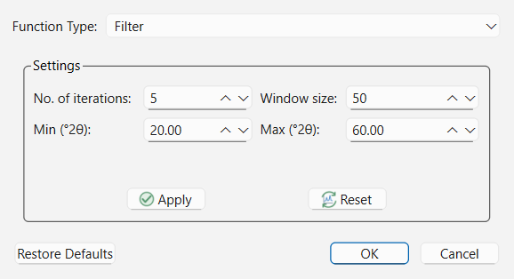
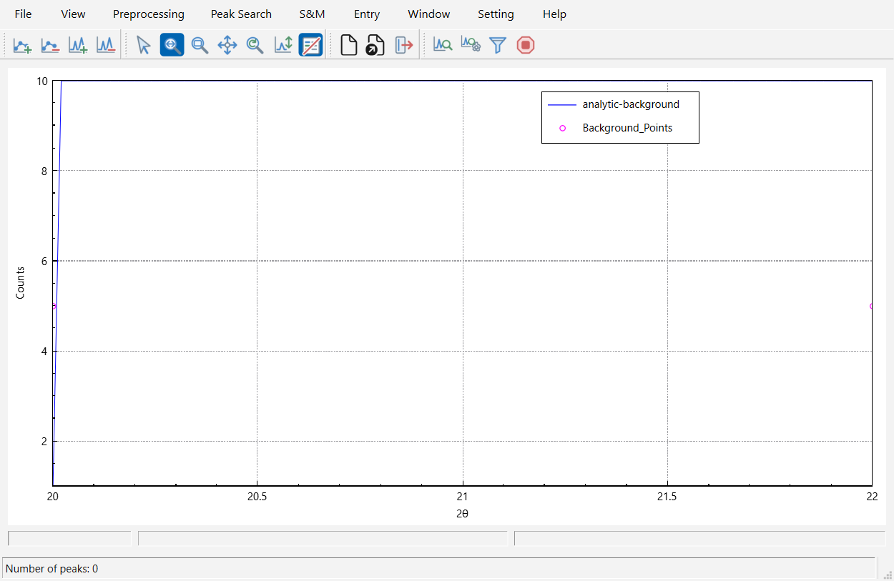
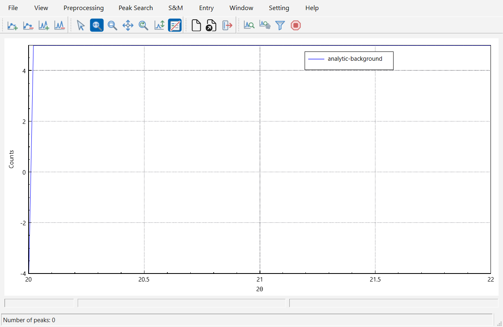

# Background Estimation and Editing

An accurate background model is essential both for **Classical Peak-List Search-Match (CSM)**—where background curvature affects peak-base placement and integrated/net peak intensities—and for **Profile-Fitting Search-Match (PFSM)**, which fits crystalline phase templates on top of the estimated background curve.

In **QualPF**, background estimation is controlled via **Preprocessing > Background** (`Ctrl+B`), **Preprocessing > Background Options...**, and interactive background control-point tools.

---

## Background Estimation Methods (`Preprocessing > Background Options...`)

Choose **Preprocessing > Background Options...** to open the **Background** configuration dialog.

When **Function Type** is switched to **Filter**, the dialog displays the iterative Bruckner smoothing-minimum filter controls:

### Supported Background Function Types

| Function Type | Mathematical Model | Best Suited For |
| :--- | :--- | :--- |
| **Chebyshev** (Default) | Orthogonal Chebyshev polynomial series $\sum_{k=0}^{N-1} c_k T_k(x)$ fitted to background base points | General-purpose laboratory and synchrotron patterns; numerically stable up to high orders (`1`–`36` coefficients) and handles broad low-angle air-scatter roll-offs well. |
| **Polynomial** | Standard power polynomial $\sum_{k=0}^{N-1} a_k x^k$ fitted to background base points | Smooth, gently varying backgrounds requiring low-to-moderate polynomial degree (`1`–`12` coefficients). |
| **Cosine Fourier Series** | Trigonometric cosine series fitted to background base points | Periodic or undulating background baselines (`1`–`12` coefficients). |
| **Cubic Spline** | Piecewise cubic spline interpolation through background control points | Patterns with localized amorphous humps (e.g., glass capillaries or polymer substrates) where manual control points guide the curve. |
| **Bezier Spline** | Smooth Bezier curve governed by background control points | Highly smooth, tensioned baseline curves guided by control points without spline overshoot. |
| **Filter** (Bruckner) | Iterative moving-average minimum filter operating directly on pattern intensities | Complex, rapidly varying backgrounds or patterns where automatic base-point selection struggles; requires no control points. |
| **None** | Zero / flat disabled background | Pre-subtracted patterns imported from external software where background removal has already been performed. |

---

## Complete Parameter Reference: `Background` Dialog

### 1. Parametric Series Models (`Chebyshev`, `Polynomial`, `Cosine Fourier Series`)

| Parameter | Default | Range / Options | Role and Effect |
| :--- | :--- | :--- | :--- |
| **Function Type** | `Chebyshev` | `Chebyshev`, `Polynomial`, `Cosine Fourier Series`, `Cubic Spline`, `Bezier Spline`, `Filter`, `None` | Selects the active background estimation algorithm. |
| **Automatic** | Checked | Checked / Unchecked | When checked, QualPF automatically determines the optimal number of basis coefficients by evaluating fit quality across candidate orders. Uncheck to lock a fixed number of coefficients. |
| **No. of coefficients** | `6` | `1` – `36` (`Chebyshev`) `1` – `12` (`Polynomial`, `Cosine Fourier Series`) | Number of basis terms fitted to the background control points when **Automatic** is unchecked. Higher values allow sharper curvature but can cut into broad diffraction peaks if set too high. |

### 2. Iterative Filter Model (`Filter`)

| Parameter | Default | Range / Options | Role and Effect |
| :--- | :--- | :--- | :--- |
| **No. of iterations** | `5` | `0` – `1000` | Number of Bruckner filter passes applied to erode Bragg peaks down to the underlying baseline. Increase if broad peaks remain partially inside the background curve. |
| **Window size** | `50` | `1` – `1000` (samples) | Half-window width (in pattern data points) of the moving average in each filter iteration. Should be wider than the broadest Bragg reflection you want to preserve. |
| **Min (°2θ)** / **Max (°2θ)** | Active calculation range | Within pattern bounds | Restricts the Bruckner filter pass to a specific angular sub-interval. |
| **Apply** | Button | Live preview | Executes the filter with the current parameters and updates the background curve on the central plot immediately. |
| **Reset** | Button | Restore pre-filter state | Reverts uncommitted filter preview changes inside the dialog. |

---

## Interactive Background Control-Point Editing

For `Chebyshev`, `Polynomial`, `Cosine Fourier Series`, `Cubic Spline`, and `Bezier Spline` models, the background curve is fitted through a set of **background base points** shown as markers along the base of the diffraction pattern. You can refine these points interactively on the central plot:

1. **Add Background Points (`Preprocessing > Add Background Points`)**:
   Activate this mode and left-click anywhere along the baseline of the diffraction pattern (for example, between overlapping peak clusters or across an amorphous halo) to insert a new anchor point. The background curve updates immediately.
2. **Delete Background Points (`Preprocessing > Delete Background Points`)**:
   Activate this mode and left-click an existing background anchor point (or drag a box around multiple anchor points) to remove points that were accidentally placed on a peak tail.
3. **Clear Background Points (`Preprocessing > Clear Background Points`)**:
   Removes all custom background control points and re-initializes the automatic base-point set.

---

## Inspecting the Background-Subtracted Pattern (`View > Subtract Background`)

Once a background curve has been calculated, you can toggle between the raw/working view and the net background-subtracted view at any time using **View > Subtract Background** (`Ctrl+Shift+B`) or the corresponding toolbar icon.

| Raw Pattern with Overlaid Background (`Subtract Background` Off) | Net Background-Subtracted Pattern (`Subtract Background` On) |
| :---: | :---: |
|  |  |

> **Tip:** > Toggling **View > Subtract Background** changes how the pattern is displayed and how classical peak overlays are inspected, while preserving the underlying raw counts and background vector for PFSM Poisson weighting.
