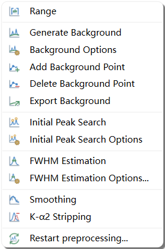

# Data Reduction Overview and Angular Range

Data reduction (accessed from the **Preprocessing** menu) prepares an experimental powder diffraction pattern for phase identification. In **QualPF**, you can execute data-reduction steps manually when their required inputs are available, or let **S&M > PFSM** / **S&M > CSM (Classical SM)** automatically execute missing prerequisite steps according to your project's workflow settings.

---

## Standard Data-Reduction Sequence

| Step | Menu Command | Purpose | Required By |
| :--- | :--- | :--- | :--- |
| **1. Wavelength** | Radiation dialog during import when wavelength metadata is absent | Defines incident radiation kind (`X-ray`, `Synchrotron`, `Neutron`), primary wavelength $\lambda_1$, and optional $\lambda_2$ ($K\alpha_2$) doublet ratio. | All workflows (converts $2\theta \leftrightarrow d$). |
| **2. Range** | **Preprocessing > Range...** | Crops the active calculation interval $[\text{Min } 2\theta, \text{Max } 2\theta]$ to exclude noisy low- or high-angle boundaries. | Optional (recommended when beam spill or detector cutoffs are present). |
| **3. Background** | **Preprocessing > Generate Background** / **Background Options...** | Estimates the continuous background curve using polynomial/series bases, splines, or a Bruckner filter, with optional manual control points. | **PFSM**, **Peak Search**, and **CSM** ([Background](background.md)). |
| **4. Initial Peak Search** | **Preprocessing > Initial Peak Search** / **Initial Peak Search Options...** | Detects initial peak candidates from the Savitzky-Golay third derivative of the spectrum for Gaussian FWHM preparation; geometric detection and formal extraction are separate. | Gaussian **FWHM Estimation** ([Initial Peak Search](initial-peak-search.md)). |
| **5. FWHM Estimation** | **Preprocessing > FWHM Estimation** / **FWHM Estimation Options...** | Determines a representative Full Width at Half Maximum (FWHM) via Gaussian fitting, Geometric estimation, or a fixed default width. | **PFSM** (profile template width) and **Peak Search** ([FWHM & Peak Search](peak-search.md)). |
| **6. Smoothing (Optional)** | **Preprocessing > Smoothing...** | Reduces high-frequency counting noise using Savitzky-Golay or Adjacent-Averaging filters. | Optional ([Smoothing](smoothing.md)). |
| **7. K-alpha2 Stripping (Optional)** | **Preprocessing > K-alpha2 Stripping** | Removes $K\alpha_2$ doublet peaks from bichromatic laboratory X-ray patterns. | Optional ([K-alpha2 Stripping](kalpha2-stripping.md)). |
| **8. Formal Peak Search** | **Peak Search > Peak Search** / **Peak Search Options...** | Extracts the discrete experimental peak table ($2\theta$, $d$, $I$, FWHM) displayed in the **Peaks** dock. | **CSM** ([FWHM & Peak Search](peak-search.md#formal-peak-search-options)). |

---

## Selecting the Calculation Range (`Preprocessing > Range...`)

Low-angle beam spill, air scatter near the direct beam, or high-angle detector edge drop-offs can distort background polynomials and introduce spurious boundary peaks. Use **Preprocessing > Range...** to restrict all subsequent calculations to a clean angular interval.

### Parameter Reference: `Range` Dialog

| Parameter / Control | Default | Range / Behavior | Role and Effect |
| :--- | :--- | :--- | :--- |
| **Min (°2θ)** | Pattern start angle | Pattern minimum to current `Max` | Sets the lower angular boundary of the active calculation range. Synchronized with the left vertical double-line cursor on the central plot. |
| **Max (°2θ)** | Pattern end angle | Current `Min` to pattern maximum | Sets the upper angular boundary of the active calculation range. Synchronized with the right vertical double-line cursor on the central plot. |
| **Apply** | Button | Live preview | Previews the cropped angular range in the central plot without closing the dialog. |
| **OK** | Button | Commit & close | Commits the new calculation range to the project state and records a `Range` step in **Workflow — Current Project**. |
| **Cancel** | Button | Discard & close | Restores the previous calculation range and closes the dialog. |

### Interactive Range Selection Procedure

1. Choose **Preprocessing > Range...** from the menu bar. Two vertical boundary cursors appear at the left and right edges of the central diffraction plot.
2. Adjust the lower and upper $2\theta$ limits using either method:
   - Drag the left and right vertical boundary cursors directly on the plot canvas; or
   - Enter exact numeric values into the **Min** and **Max** spin boxes.
3. Click **Apply** to preview the cropped domain, then click **OK** to commit.

> **Note:** > If downstream steps (such as Background, FWHM, Peak Search, or Search-Match) have already been computed on the project, changing the calculation range prompts you to confirm invalidating those dependent results before applying the new range.

---

## Resetting Data Reduction (`Preprocessing > Restart Preprocessing`)

At any point during an analysis, selecting **Preprocessing > Restart Preprocessing**:
- Restores the stored original observations for the current pattern domain; Range cropping is not expanded back to discarded samples, so reimport to recover the full source domain;
- Clears the modeled background curve, manual background control points, initial peak candidates, FWHM estimate, smoothing/stripping state, and extracted peak list;
- Resets the preprocessing history while preserving your global **Setting** defaults.

Undo snapshots are available only for completed steps retained in the current session; reopening QPF preserves records but not undo snapshots.

For selective step-by-step rollback (for example, undoing only Smoothing or Search-Match while keeping your Background curve), use **Undo Selected** in the **Workflow — Current Project** dock ([Inspecting and Undoing Steps](../settings.md#inspect-and-undo)).
