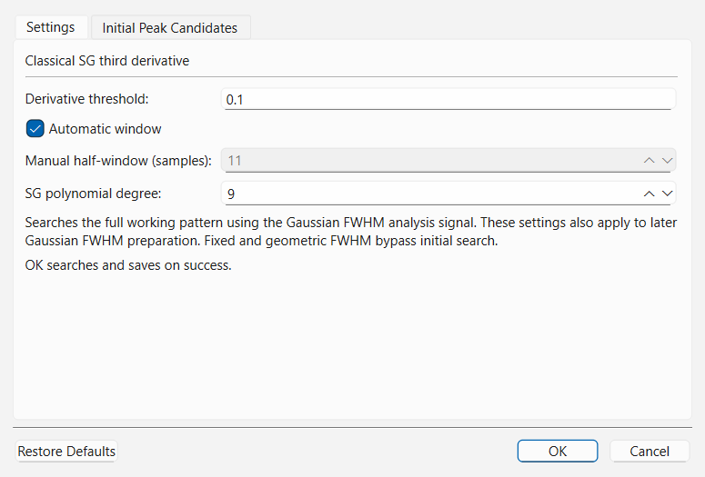
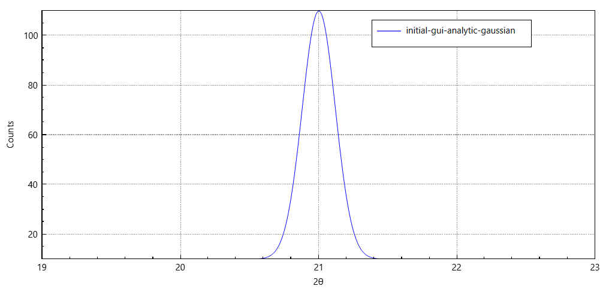

# Initial Peak Search

The **Initial Peak Search** stage records ordered SG third-derivative trigger
positions for **Gaussian fit (Classical)** FWHM preparation. It does not fit widths,
create final experimental peaks or add markers to the central plot.

**Geometric FWHM** detects its own candidates and ignores these SG settings.
Fixed width skips candidate detection. Formal **Peak Search** performs its own
detection using the calibrated width and formal extraction settings.

---

## Configuring Initial Peak Search (`Preprocessing > Initial Peak Search Options...`)

Select **Preprocessing > Initial Peak Search Options...** to open the two-tab **Initial Peak Search Options** dialog.

### Tab 1: `Settings`

### Parameter Reference: `Initial Peak Search Options` (`Settings` Tab)

| Parameter | Default | Range / Options | Role and Effect |
| :--- | :--- | :--- | :--- |
| **Derivative threshold** | `0.1` | `0.0` – `200.0` | Controls the minimum normalized Savitzky-Golay third-derivative zero-crossing slope required to register a peak candidate. **Lower values** (e.g., `0.03`–`0.08`) increase sensitivity to weak or broad reflections; **higher values** (e.g., `0.25`–`1.0`) suppress high-frequency counting noise. |
| **Automatic window** | Checked | Checked / Unchecked | When checked, QualPF automatically selects the Savitzky-Golay filter half-window $m$ based on the angular step size $\Delta(2\theta)$ of the pattern. Uncheck to unlock **Manual half-window (samples)**. |
| **Manual half-window (samples)** | `11` | `2` – `100` (integer) | Specifies the half-window width $m$ in data samples (giving a total moving window of $2m + 1$ points) when **Automatic window** is unchecked. The effective polynomial degree is capped at $2m$. Increase $m$ for heavily oversampled or noisy patterns; decrease $m$ for coarse step sizes. |
| **SG polynomial degree** | `9` | `3` – `20` (integer) | Polynomial order of the Savitzky-Golay filter used to evaluate smoothed derivatives. Higher degrees preserve narrow peak shapes better; lower degrees (`3`–`5`) apply stronger derivative smoothing. |

> The detector records the actual resolved window and polynomial degree. The requested degree is capped to the available window; no extra user rejection rule is imposed.

---

### Tab 2: `Initial Peak Candidates`

Clicking **OK** in **Initial Peak Search Options** (or running **Preprocessing > Initial Peak Search**) executes the third-derivative detector, preserves the central plot, and switches the dialog to the **Initial Peak Candidates** tab so you can inspect the detected positions immediately.

| Column | Description |
| :--- | :--- |
| **Sample** | One-based sample number in the working diffraction pattern where the derivative trigger was detected, before peak-top refinement. Internal evidence uses zero-based indices; this table adds one for display. |
| **2θ (°)** | Angular position of the initial peak candidate in degrees $2\theta$. |
| **Observed intensity** | Working pattern intensity at the candidate sample index. |

The central diffraction plot remains unchanged while this read-only candidate table is inspected:

---

## Practical Tuning Guidelines

- **When Gaussian `FWHM Estimation` reports too few usable peaks**:
  Open **Preprocessing > Initial Peak Search Options...**, lower **Derivative threshold** (for example, from `0.1` to `0.05`), and click **OK**. Check the **Initial Peak Candidates** tab to confirm that clean single reflections are now detected.
- **When noisy low-count scans produce dozens of false-positive noise spikes**:
  Increase **Derivative threshold** (for example, to `0.25`–`0.50`) or uncheck **Automatic window** and increase **Manual half-window (samples)** (e.g., `15`–`21`) while lowering **SG polynomial degree** to `5`.
