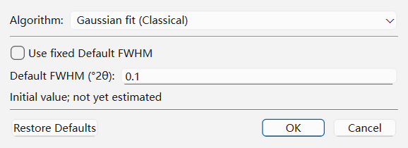
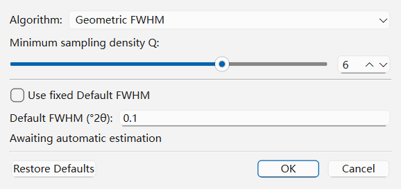
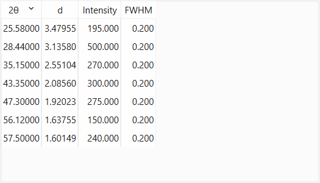

# FWHM Estimation and Peak Search

In **QualPF**, representative Full Width at Half Maximum (**FWHM**) estimation and formal **Peak Search** work together to characterize the reflections in your diffraction pattern:

- **FWHM Estimation (`Preprocessing > FWHM Estimation` / `FWHM Estimation Options...`)** determines a single representative peak width (in degrees $2\theta$) for the active pattern. This width is required both by **PFSM** (to expand reference reflection sticks into continuous fixed Intermediate Lorentzian profile templates) and by **Peak Search** (to scale peak-picking windows and assign fallback widths).
- **Peak Search (`Peak Search > Peak Search` / `Peak Search Options...`)** extracts a discrete table of experimental reflections ($2\theta$, $d$, Intensity, FWHM) displayed in the **Peaks** dock and consumed by **Classical Peak-List Search-Match (CSM)**.

---

## Representative FWHM Estimation (`Preprocessing > FWHM Estimation Options...`)

Choose **Preprocessing > FWHM Estimation Options...** to configure how QualPF determines the representative peak width of the working pattern.

### Parameter Reference: `FWHM Estimation Options` Dialog

| Parameter | Default | Range / Options | Role and Effect |
| :--- | :--- | :--- | :--- |
| **Algorithm** | `Gaussian fit (Classical)` in this manual Preprocessing dialog | `Gaussian fit (Classical)`, `Geometric FWHM` | Chooses automatic estimation when fixed width is off. CSM and Peak Search have separate prerequisite profiles; automatic PFSM preparation uses geometric estimation. |
| **Minimum sampling density Q** | `6` | `2` – `8` (integer) | Geometric only. Requires FWHM divided by the largest local sample step to be at least $Q$. Lowering $Q$ may admit coarser peaks. If none is eligible, the operation stops; it does not switch to a fixed width. |
| **Use fixed Default FWHM** | Unchecked | Checked / Unchecked | When checked, disables automatic `Gaussian fit` and `Geometric FWHM` estimation and directly assigns **Default FWHM (°2θ)** as the representative pattern width. Fixed and automatic geometric PFSM widths both bypass the separate SG Initial Peak Search. |
| **Default FWHM (°2θ)** | `0.1` | `> 0.0` – `180.0` | Explicit fixed width in degrees $2\theta$. Automatic estimation failure stops the operation; it does not silently use this value. The field is read-only in automatic mode. |

### Comparing the Three FWHM Modes

1. **Gaussian fit (Classical)**:
   Fits and refines candidates from **Initial Peak Search**, then averages the
   widths of the up to three strongest usable peaks. This is not an average over
   every detected peak. A failed automatic GUI estimate stops downstream work.
2. **Geometric FWHM**:
   Uses the [IAEA F1 half-maximum chord construction](../references.md#f1-iaea-fwhm-procedure)
   with its own candidate detection. It chooses the strongest eligible peak by
   net height; uncertainty, prominence and sample order break ties. It does not
   average all eligible widths. Automatic PFSM preparation uses this route.
3. **Fixed Default FWHM**:
   Directly applies the user-supplied **Default FWHM (°2θ)** value. Ideal when analyzing patterns with very few or severely overlapped reflections where automatic single-peak isolation is not possible.

This dialog executes and saves the **Preprocessing** profile. Changing its width
does not rerun an existing peak table. A later CSM/Peak Search preparation reuses
only compatible evidence or uses that workflow's own settings. PFSM can reuse a
compatible manually measured width; its templates all share one physical width,
with no per-phase or angle-dependent width refinement.

---

## Formal Peak Search Options

To extract or update the discrete experimental peak table in the **Peaks** dock, select **Peak Search > Peak Search** or open **Peak Search > Peak Search Options...**.

### Parameter Reference: `Peak Search Options` Dialog

| Group | Parameter | Default | Range / Options | Role and Effect |
| :--- | :--- | :--- | :--- | :--- |
| **Interval** | **Append new peaks** | Unchecked | Checked / Unchecked | When unchecked, running Peak Search replaces the entire experimental peak list. When checked, existing peaks outside the $[\text{Min}, \text{Max}]$ search sub-interval are preserved and newly detected peaks inside $[\text{Min}, \text{Max}]$ are merged into the table. |
| **Interval** | **Min (°2θ)** | Pattern start angle | Within calculation range | Lower angular bound for peak extraction. Synchronized with the left vertical cursor on the central plot. |
| **Interval** | **Max (°2θ)** | Pattern end angle | Within calculation range | Upper angular bound for peak extraction. Synchronized with the right vertical cursor on the central plot. |
| **Settings** | **Intensity threshold (%)** | `1.50` | `0.00` – `100.00` | Height threshold relative to the strongest candidate in the current detection pool. Changing it reselects that pool; it cannot restore candidates rejected during detection/refinement. The reference maximum is computed before the selected interval is applied. |
| **Settings** | **Sensitivity** | Derived from the current extraction window | `0` – `100` (slider & spinbox) | Higher values request a smaller SG half-window and rerun detection. This can expose narrow features and noise; it is not a direct change to the derivative threshold and does not guarantee shoulder separation. |
| **Settings** | **Number of peaks** | Current selected count | `0` to the detected candidate count | Selects the strongest $N$ available candidates in the interval. Updates the height threshold only when **Append new peaks** is off. It is a count field, not an enable checkbox. |

Changing interval bounds, height or count reselects existing candidates without
remeasuring FWHM. Changing Sensitivity redetects within the selected interval and
reevaluates width preparation. Fresh extraction can retry with a `0.6%` threshold
when too few peaks were found, so inspect the applied threshold and result.
Manual peak edits and imports invalidate the detector pool; reopening Options
cannot reconstruct rejected or unavailable candidates merely by lowering a filter.

> **Tip:** > Combining **Append new peaks** with a narrow **Min / Max (°2θ)** window lets you apply high sensitivity (`Sensitivity = 85`, `Intensity threshold = 0.3%`) in a specific high-angle region without flooding the low-angle region with noise peaks.

---

## Inspecting and Editing the `Peaks` Dock

All extracted and manually added experimental peaks are listed in the **Peaks** dock (**Window > Peaks**).

### `Peaks` Dock Columns and Context Actions

| Column / Action | Description |
| :--- | :--- |
| **2θ (°)** | Bragg angle of the experimental reflection in degrees $2\theta$. |
| **d (Å)** | Interplanar spacing $d = \lambda_1 / (2 \sin\theta)$ in Ångströms calculated from the primary wavelength. |
| **Intensity** | Current peak height. Formal extraction subtracts the modeled background and then a local straight baseline. CSM residual acceptance can reduce this value or remove the row; it is not always the original extracted height. |
| **FWHM (°2θ)** | Full Width at Half Maximum of the individual reflection in degrees $2\theta$. |
| **Right-Click > Add Peak** | Opens the **Add table peak** dialog to enter a coordinate, intensity and width. |
| **Right-Click > Modify measured peak...** | Opens the **Modify table peak** dialog for the row under the context menu. |
| **Double-click a numeric cell** | Edits that value directly in the table. It does not open the full-row dialog. The other measurements are retained; rejected input restores the prior table and reports the failure. |
| **Right-Click > Delete Peaks** | Removes the highlighted row(s) from the experimental peak list. |

---

## Adding and Modifying Peaks Manually

Even with optimal automatic settings, weak shoulders or partially overlapped reflections may benefit from manual refinement. QualPF provides both **tabular** and **graphical** manual peak tools.

### 1. Tabular Peak Addition and Modification (`Add / Modify table peak` Dialog)

Choose **Add Peak** or **Modify measured peak...** from the Peaks dock's context
menu to open the **Add table peak** or **Modify table peak** dialog. Use this
dialog for width inference or an explicit area change; double-clicking a table
cell instead edits just that numeric value.

| Parameter | Default | Options / Range | Role and Effect |
| :--- | :--- | :--- | :--- |
| **Coordinate representation** | `2 theta` | `2 theta`, `d spacing` | Chooses whether you enter the peak position in degrees $2\theta$ (`2 theta`) or in Ångströms (`d spacing`). QualPF automatically converts the complementary coordinate using the active primary wavelength $\lambda_1$. |
| **Position (°2θ)** / **d-spacing (Å)** | Selected peak coordinate | Valid diffraction domain | Requires $0<2\theta<180^\circ$ and $d>\lambda/2$. Typed table positions are not restricted to the measured scan interval; they do not extend the continuous spectrum. Duplicate positions are refused. |
| **Intensity** | Selected peak height | `>= 0` | Net peak intensity assigned to the reflection. |
| **Infer width from neighboring peaks** | Unchecked | Checked / Unchecked | Disables manual FWHM entry. Uses a single/outer neighbor's width or the mean of the neighboring pair around the position. With no neighbors, uses `0.2`°; absence of neighbors alone is not a failure. The edited row is excluded from its own neighbor list. |
| **FWHM (°2θ)** | Enter or retain a measured width | Finite and positive | Explicit Full Width at Half Maximum in degrees $2\theta$ when **Infer width from neighboring peaks** is unchecked. |

### 2. Graphical Peak Addition and Deletion on the Central Plot

- **Add Peak on Graph (`Peak Search > Add Peak`)**:
  Activate **Add Peak** from the **Peak Search** menu or toolbar, then left-click on a peak maximum in the central diffraction plot. The measured-peak dialog requires explicit intensity and FWHM. **Add inferred peak** is a separate command; it does not silently replace a failed measured input.
- **Delete Peak on Graph (`Peak Search > Delete Peak`)**:
  Activate **Delete Peak** and click near a peak to remove the nearest angular
  position. This mode deletes one peak per click. To remove several, select
  rows in the **Peaks** dock and use **Delete Peaks**.

When the snapshot includes integrated intensities, manual edits also require an
explicit area. Formal extraction stores a trapezoidal integral of its
background-subtracted analysis samples; unlike the height, that integral does
not subtract the extra local straight baseline. Manual areas retain the values
you enter. Cancel preserves the prior table.

A changed matching input (position, height, width or table membership) clears
candidate/accepted-phase results, restores original heights of surviving rows
and recalculates automatic tolerance. Removed rows are not reconstructed. Manual
changes invalidate the detection pool; an unchanged edit leaves results intact.
