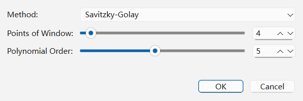

# Smoothing

Rapidly acquired powder diffraction scans or patterns collected from weakly scattering samples often exhibit high-frequency counting noise ($\sqrt{N}$ shot noise). The **Smoothing** tool (**Preprocessing > Smoothing...**) applies a digital smoothing filter to the working diffraction pattern to improve visual clarity and stabilize derivative-based peak picking.

---

## Smoothing Methods and Parameters (`Preprocessing > Smoothing...`)

Select **Preprocessing > Smoothing...** from the menu bar to open the **Smoothing** dialog.

### Parameter Reference: `Smoothing` Dialog

| Parameter | Default | Range / Options | Role and Effect |
| :--- | :--- | :--- | :--- |
| **Method** | `Savitzky-Golay` | `Savitzky-Golay`, `Adjacent-Averaging` | Selects the digital filter algorithm applied to the working pattern intensities. |
| **Points of Window** | `4` | `2` – `50` (`Savitzky-Golay`) `1` – `50` (`Adjacent-Averaging`) | Half-window in sample points; a value $m$ uses $2m+1$ samples. Larger window widths remove more noise but increase the risk of broadening narrow reflections or clipping peak maxima. |
| **Polynomial Order** | `5` | `1` – `10` | Savitzky-Golay only. Must be at most twice the half-window; an incompatible degree is rejected, not automatically capped. The pattern must contain at least a full window of samples. |

---

## Comparing `Savitzky-Golay` and `Adjacent-Averaging`

1. **Savitzky-Golay (Recommended)**:
   Fits a local polynomial of degree $k$ (**Polynomial Order**) across $2m+1$ points, where $m$ is **Points of Window** by linear least squares. Unlike a simple moving average, a local polynomial can retain shape better than averaging, but smoothing can still alter peak heights, areas and widths. Inspect the preview before committing.
2. **Adjacent-Averaging**:
   Uses the arithmetic mean over the full window in the interior and shorter
   symmetric windows near the ends, retaining the endpoint values. A pattern
   shorter than the full window is unchanged by averaging. Large windows can
   attenuate narrow maxima and change reflection widths.

Savitzky-Golay also preserves endpoints and uses reduced fitting neighborhoods
near boundaries; where there are too few points for the requested degree, it
retains that sample. Preview failures and Cancel leave the committed pattern
unchanged. Successful intensity changes invalidate peak/FWHM/search results
after the applicable dependency confirmation; they do not overwrite stored
original observations.

---

## Scientific Best Practices and Effect on PFSM

> **Important:** > **How Smoothing Interacts with PFSM Weighting**:
> Smoothing modifies the **working pattern** intensities and correlates adjacent data points. When **S&M > PFSM** is executed:
> - `Auto from input` uses attested noise only when it remains compatible with the working signal. Smoothing makes that original-statistics route unavailable, so the current GUI uses equal weights.
> - Current text/CIF importers do not attest Poisson counts or variances merely from positive intensities. Inspect the **Resolved** readout.
> - Choose a modest window and inspect changes in weak and overlapping reflections before accepting the preview.

### Recommended Tuning Guidelines

- **For standard step scans ($\Delta 2\theta = 0.01^\circ\text{–}0.02^\circ$)**: Use `Savitzky-Golay` with **Points of Window** = `2` to `4` (full windows of `5` to `9` samples) and **Polynomial Order** = `3`.
- **If peak tops appear slightly clipped after smoothing**: Click **Undo Selected** on the `Smoothing` step in the **Workflow — Current Project** dock (or **Preprocessing > Restart Preprocessing**) and either reduce **Points of Window** or increase **Polynomial Order** from `2` to `3` or `4`.
