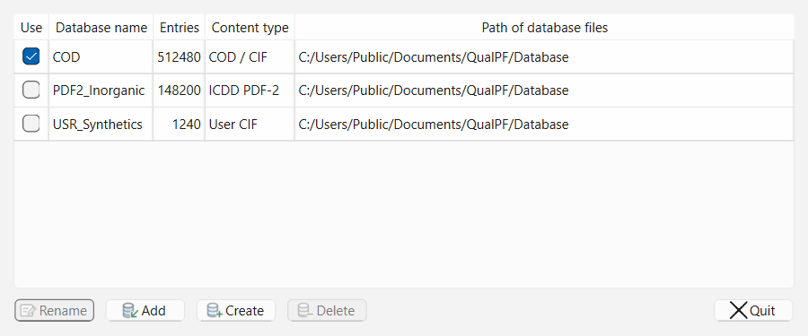
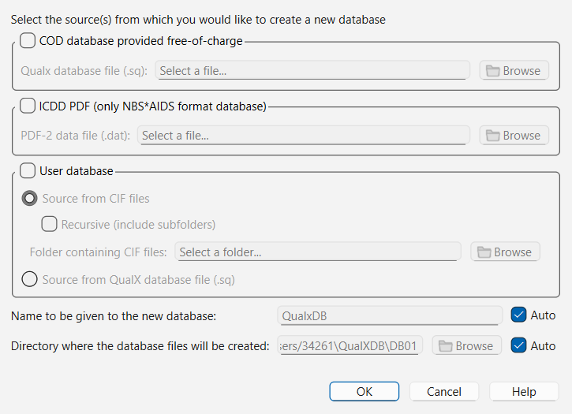

# Database Installation and Management

QualPF performs phase identification by matching experimental diffraction data against local SQLite-based reference databases. You can register pre-built databases or compile new databases directly from **Crystallography Open Database (COD)** distributions, **ICDD PDF-2** ASCII files, or **User CIF** collections.

All database operations are accessed from the **S&M > Manage Databases** menu command.

---

## The Manage Databases Dialog

Choose **S&M > Manage Databases** from the menu bar to open the **Manage Databases** dialog.

### Database Table Columns

| Column | Description |
| :--- | :--- |
| **Use** | Checkbox controlling whether the database is active during search-match and restraint card browsing. Exactly one database is selected at a time; selecting another switches the active database. |
| **Database** | User-editable display name of the database in QualPF (for example, `COD`, `PDF2_Inorganic`, or `USR_Synthetics`). Click **Rename** to change the display name; the table cell is read-only. |
| **Entries** | Total number of crystallographic phase cards indexed in the database. |
| **Content** | Source format / category description reported by the database metadata (for example, `COD / CIF`, `ICDD PDF-2`, or `User CIF`). |
| **Path** | Filesystem directory containing the database files (`.sq`, `.sq.info`, `.sq.infostat`, `.sq.search`). |

### Manage Databases Action Buttons

| Button | Role and Behavior |
| :--- | :--- |
| **Rename** | Edits the display name (**Database** column) of the currently highlighted row without renaming files on disk. |
| **Add** | Opens a file browser to register an existing QualPF/QualX database file (`*.sq`) already present on disk. QualPF automatically validates the required companion files in the same folder. |
| **Create** | Opens the **Create Database** dialog to register an existing COD/QualX `.sq` database or build a new database from ICDD PDF-2 or user CIF inputs. |
| **Delete** | Removes the selected database from QualPF's catalog. The confirmation prompt includes an optional checkbox: **Also delete database files from disk (.sq, .sq.info, .sq.infostat, .sq.search)**. This checkbox starts checked. Uncheck it to unregister the database while keeping its files on disk. |
| **Quit** | Saves changes to the active database catalog and closes the dialog. |

---

## Companion Database Files on Disk

Every searchable QualPF database consists of a primary `.sq` file accompanied by index and metadata files in the same directory:

| File Extension | Required | Purpose |
| :--- | :---: | :--- |
| `<name>.sq` | Yes | Primary SQLite database storing phase cards, reflections ($d$, $I$), chemical formulas, symmetry, cell parameters, and RIR values. |
| `<name>.sq.info` | Yes | SQLite bibliographic and crystallographic details, including unit-cell/property records. |
| `<name>.sq.search` | Yes | Pre-indexed search acceleration tables used by CSM and PFSM candidate screening. |
| `<name>.sq.infostat` | Yes | Statistical summary metadata generated during database creation. |

> **Warning:** > Always keep `<name>.sq`, `<name>.sq.info`, `<name>.sq.search`, and `<name>.sq.infostat` together in the same directory. Moving `<name>.sq` without its `.sq.info` and `.sq.search` companion files will prevent **Add** from registering the database.

---

## Creating or Importing a Database (`Create Database` Dialog)

Click **Create** inside **Manage Databases** to open the **Create Database** dialog.

The **Create Database** dialog is organized into two sections:

1. **Input source selection** (top three mutually exclusive group boxes: **COD database**, **ICDD PDF**, and **User database**). Checking one source group automatically unchecks the other two.
2. **Output destination settings** (**Database name** and **Database folder** at the bottom).

### Parameter Reference: `Create Database` Dialog

| Section / Parameter | Default | Options / Format | Role and Effect |
| :--- | :--- | :--- | :--- |
| **COD database** (group checkbox) | Checked | Enabled / Disabled | Registers an existing COD `.sq` database with its three companion files at their current location. Unpack downloaded archives first; registration does not copy files or rebuild indexes. |
| **COD file** | Empty | Path to `*.sq` | Path to the input COD `.sq` file. Click **...** to browse. |
| **ICDD PDF** (group checkbox) | Unchecked | Enabled / Disabled | Selects an official ICDD Powder Diffraction File (PDF-2) distribution in NBS*AIDS83 ASCII format for conversion into a QualPF SQLite database. |
| **PDF file** | Empty | Path to `*.dat` | Path to the licensed ICDD PDF-2 `.dat` file in NBS*AIDS83 format. |
| **User database** (group checkbox) | Unchecked | Enabled / Disabled | Builds a database from a folder of Crystallographic Information Files (`.cif`) or registers an existing `.sq` database. |
| **CIF files** (radio button) | Selected | Radio option | Compiles diffraction patterns and phase cards directly from `.cif` structure or powder files inside the chosen **CIF folder**. |
| **CIF folder** | Empty | Directory path | Root folder containing `.cif` files to import. |
| **Scan subfolders recursively** | Unchecked | Checked / Unchecked | When checked, QualPF traverses all nested subdirectories under **CIF folder** and imports every valid `.cif` file found. When unchecked, only `.cif` files in the top-level folder are imported. |
| **QualX database (.sq)** (radio button) | Unselected | Radio option | Registers the existing database specified in **Database file**, using its current files and indexes. |
| **Database file** | Empty | Path to `*.sq` | Path to the custom `.sq` file when **QualX database (.sq)** is selected. |
| **Database name** | `COD` | Text string | Base filename and initial display name for the generated database. |
| **Automatic name** | Checked | Checked / Unchecked | Automatically sets **Database name** to `COD` (for COD sources), `PDF` (for ICDD PDF sources), or `USR` (for User CIF/database sources). Uncheck to enter a custom name (e.g., `MyLab_Ceramics`). |
| **Database folder** | System default | Directory path | Output directory where `<name>.sq` and its companion `.sq.info`, `.sq.search`, and `.sq.infostat` files will be written. |
| **Automatic folder** | Checked | Checked / Unchecked | Uses the standard QualPF compatible home-directory `QualXDB` location for storing generated database files. Uncheck to choose a custom storage drive or folder. |

---

## Step-by-Step Database Workflows

### 1. Registering an Existing `.sq` Database (`Add`)

Use this workflow if you already have a compiled database directory containing all four files listed above:

1. Open **S&M > Manage Databases**.
2. Click **Add**.
3. Browse to the folder containing the database, select `<name>.sq`, and click **Open**.
4. Enter its display name when prompted.
5. Check **Use** for the new row if you want to switch to it, then click **Quit**. The first registered database is selected automatically.

### 2. Installing the Crystallography Open Database (COD)

1. Open **S&M > Manage Databases** and click **Create**.
2. Keep **COD database** checked.
3. Click **...** next to **COD file** and select the downloaded COD `.sq` file.
4. Keep **Automatic name** (`COD`) checked or enter a custom display name. The existing database stays at the selected path; **Database folder** is not used for registration.
5. Click **OK**. All three companion files must be present; QualPF registers their existing indexes.
6. Check **Use** next to `COD` to select it in **Manage Databases**, then click **Quit**.

### 3. Building a Custom Database from Local CIF Files

When working with proprietary synthetic phases, newly refined crystal structures, or project-specific mineral subsets:

1. Place your `.cif` files into a folder on disk.
2. Open **S&M > Manage Databases** and click **Create**.
3. Check **User database** and select the **CIF files** radio button.
4. Click **...** next to **CIF folder** and select your CIF directory.
5. Check **Scan subfolders recursively** if your `.cif` files are organized into nested subdirectories.
6. Uncheck **Automatic name** and enter a descriptive name (such as `USR_BatteryCathodes`).
7. Click **OK**. QualPF parses each CIF entry, calculates reflection $d$-spacings, intensities, and reference RIR values where atomic structure data are present, and registers the resulting database in **Manage Databases**.

### 4. Building an ICDD PDF-2 Database

1. Open **S&M > Manage Databases > Create** and select **ICDD PDF**.
2. Choose your PDF-2 `.dat` input in **PDF file**.
3. Set **Database name** and **Database folder**, then click **OK**.
4. After a successful build, select its **Use** checkbox and click **Quit**.

A parsing or database write failure reports a failed build and does not register
it as successful. Cancellation can leave already committed records in the output
files; those partial files are not automatically registered. Keep the original
input and rebuild into a suitable output location before using the database.
