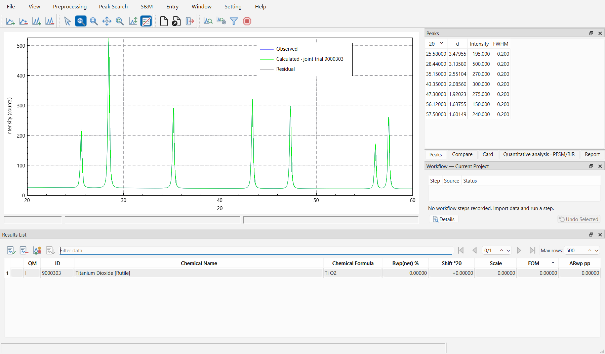

# QualPF User Manual

**QualPF** is a scientific desktop application for qualitative and semi-quantitative phase identification from powder diffraction data. It supports experimental powder diffraction patterns, with **X-ray**, **synchrotron**, and **neutron** import settings and combines two complementary search-match paradigms in a unified workspace:

- **CSM (Classical Peak-List Search-Match)** — evaluates candidate reference phases using experimental peak positions/intensities together with a real continuous spectrum and calculation range; a peak table alone is insufficient.
- **PFSM (Profile-Fitting Search-Match)** — evaluates candidate reference phases against the continuous working diffraction profile using bounded constant angular shifts per phase, full-profile templates, multi-channel candidate recall, and non-negative least-squares joint multiphase fitting.

---

## Core Capabilities at a Glance

| Capability Area | Key Features in QualPF | Manual Reference |
| :--- | :--- | :--- |
| **Pattern & Project I/O** | Import multi-column ASCII/XY/DAT patterns and powder CIFs; save and reopen complete project states (`.qpf` only; QXP is rejected); export active patterns, peak tables, phase tables, and PDF reports. | [Getting Started](introduction/getting-started.md) |
| **Radiation & Wavelengths** | Configure X-ray, synchrotron or neutron import settings; select standard anode or custom wavelengths and declare a second radiation component when appropriate. Fixed Cu stripping has its own narrower admission rules. | [Getting Started — Radiation](introduction/getting-started.md#radiation-and-wavelength-configuration) |
| **Data Reduction (Preprocessing)** | Angular range cropping, 7 background estimation modes (Chebyshev, Polynomial, Cosine Fourier, Cubic Spline, Bezier Spline, Bruckner Filter, None) plus interactive background point editing, Savitzky-Golay 3rd-derivative initial peak search, Gaussian/Geometric/Fixed FWHM estimation, formal peak search & manual/inferred peak editing, Savitzky-Golay / Adjacent-Averaging smoothing, and Rachinger $K\alpha_2$ stripping. | [Data Reduction Overview](data-reduction/index.md) |
| **Reference Databases** | Register, activate, rename, and build SQLite reference databases (`.sq` + companion index files) from the Crystallography Open Database (COD), licensed ICDD PDF-2 distributions, or custom CIF folders. | [Database Installation](database-installation.md) |
| **Restraints & Card Browsing** | Filter candidates using composition, species count, subfiles, name/color/density, entry IDs, symmetry and unit-cell parameters. Classical card browsing is scored when experimental peaks are present and unscored otherwise; PFSM does not support this browse/merge route. | [Restraints](search-match/restraints.md) |
| **Search-Match & Quantification** | Run CSM or PFSM with configurable Figure of Merit (FOM) weights, shift bounds, weighting policies, template caching, and bounded candidate recall; inspect live joint profile trials; accept phases into the working solution; perform Reference Intensity Ratio (RIR) semi-quantitative weight-percent estimation. | [Search-Match Overview](search-match/index.md), [Executing Search-Match](search-match/search-match.md) |
| **Workflow Defaults & Provenance** | Configure persistent defaults for new projects in **Setting** while inspecting, comparing, and undoing executed project steps in the **Workflow — Current Project** dock. | [Workflow Settings & Project History](settings.md) |

---

## Standard Analysis Workflow

A typical phase identification session in QualPF proceeds through six stages:

1. **Install & Register Reference Databases** — Configure at least one reference database (`COD`, `PDF`, or `USR`) under **S&M > Manage Databases** ([Database Installation](database-installation.md)).
2. **Import Pattern & Verify Radiation** — Open an experimental diffraction pattern (**File > Import Diffraction Pattern**) and confirm incident radiation and wavelength in the import dialog when the source lacks wavelength metadata ([Getting Started](introduction/getting-started.md)).
3. **Reduce the Experimental Pattern** — Restrict the calculation range if noisy boundary regions are present, model the background curve, estimate the representative peak width (FWHM), and extract or refine experimental peaks as needed ([Data Reduction](data-reduction/index.md)).
4. **Apply Prior Restraints (Optional)** — Constrain candidate phases by known elements, subfiles, density, crystal symmetry, or unit-cell dimensions (**S&M > Restraints**) ([Restraints](search-match/restraints.md)).
5. **Run Search-Match (CSM or PFSM)** — Configure algorithm parameters (**S&M > CSM Options** or **S&M > PFSM Options**) and execute **S&M > CSM (Classical SM)** or **S&M > PFSM** ([Executing Search-Match](search-match/search-match.md)).
6. **Verify Phases, Quantify & Export** — Inspect candidate reflections and joint profile fits in the plot, **Compare** dock, and **Quantification** panel; accept matching phases; review RIR semi-quantitative percentages; and export results or print the **Report** ([Search-Match & Quantification](search-match/search-match.md#quantification)).

---

## Manual Structure

- **Setup & Workspace**
  - [Installation](installation.md) — System requirements, verified package scope, Linux source build, and first-run setup.
  - [Database Installation](database-installation.md) — Managing, registering, and building COD, ICDD PDF-2, and custom CIF databases.
  - [Introduction to Phase Identification](introduction/index.md) — Conceptual overview of powder diffraction data reduction and CSM vs. PFSM search-match routes.
  - [Getting Started](introduction/getting-started.md) — Complete tour of the main window, menu bar, toolbars, dock panels, interactive plot controls, and file/export actions.
  - [Workflow Settings and Project History](settings.md) — Managing new-project defaults (**Setting** menu) versus current-project options and step-by-step provenance (**Workflow — Current Project** dock).
  - [Worked Examples](introduction/examples.md) — End-to-end visual walkthroughs for single-phase identification, multi-phase mixtures with restraints and quantification, and low-signal/manual-recovery patterns.
- **Data Reduction (`Preprocessing` Menu)**
  - [Data Reduction Overview & Angular Range](data-reduction/index.md) — Preprocessing sequence, **Range** cropping dialog, and **Restart Preprocessing**.
  - [Background](data-reduction/background.md) — Automatic and parametric background models, Bruckner filter parameters, manual control points, and net-intensity display.
  - [Initial Peak Search](data-reduction/initial-peak-search.md) — Savitzky-Golay third-derivative initial peak candidate detection and parameter tuning.
  - [FWHM Estimation & Peak Search](data-reduction/peak-search.md) — Gaussian, Geometric, and Fixed FWHM estimation; formal **Peak Search Options**; the **Peaks** dock; and manual/inferred peak editing.
  - [Smoothing](data-reduction/smoothing.md) — Savitzky-Golay and Adjacent-Averaging smoothing filters and their impact on working observations.
  - [K-alpha2 Stripping](data-reduction/kalpha2-stripping.md) — Monochromatizing laboratory $K\alpha_1 / K\alpha_2$ doublet patterns before peak search or CSM.
- **Search-Match (`S&M` Menu)**
  - [Search-Match Overview](search-match/index.md) — Architectural comparison of CSM and PFSM, database candidate screening, and method selection criteria.
  - [Executing Search-Match, Phase Acceptance & Quantification](search-match/search-match.md) — Detailed parameter reference for **CSM Options** and **PFSM Options** (including **Candidate Recall**), candidate list evaluation, joint profile trial inspection, RIR quantification, **Compare** dock, and **Report** generation.
  - [Restraints](search-match/restraints.md) — Complete reference for the **Composition**, **Subfiles**, **Properties**, **Entries**, and **Symmetry** restraint tabs and direct card browsing.
- **Appendix**
  - [References](references.md) — Scientific literature citations and algorithmic notes.
