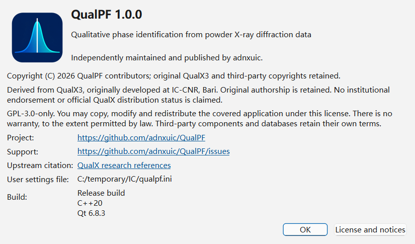

# Installation

This chapter describes hardware and operating-system requirements for **QualPF**, step-by-step installation procedures on Windows and Linux, and recommended first-run configuration checks.

---

## System Requirements

| Component | Minimum Specification | Recommended Specification (for PFSM & Large Databases) |
| :--- | :--- | :--- |
| **Operating System** | Windows 10 (64-bit) or modern 64-bit Linux distribution (glibc 2.31+) | Windows 11 (64-bit) or Ubuntu 22.04+ / Fedora 38+ (64-bit) |
| **Processor (CPU)** | 64-bit dual-core CPU | 64-bit multi-core CPU (8+ logical threads for parallel PFSM screening and profile fitting) |
| **Memory (RAM)** | 4 GB RAM | 8 GB – 16 GB RAM (when using full COD databases with PFSM template caching enabled) |
| **Disk Space** | 250 MB for QualPF application binaries | 2 GB – 10 GB free SSD space when storing indexed COD, ICDD PDF-2, or custom CIF SQLite databases |
| **Display** | $1280 \times 800$ resolution | $1920 \times 1080$ or higher resolution (allows simultaneous viewing of the central diffraction plot and surrounding dock panels) |

---

## Installing on Windows

QualPF is distributed on Windows in two formats:

### Option A: Windows Installer (Recommended)

1. Download the official Windows installer executable (`QualPF-<version>-Windows-x86_64-Setup.exe`).
2. Run the installer and follow the setup wizard:
   - Choose the destination installation directory (default: `C:\Program Files\QualPF` or per-user application directory).
   - Optionally create Start Menu and Desktop shortcuts.
3. Launch **QualPF** from the Windows Start Menu or Desktop shortcut.

### Option B: Portable Archive (`.zip`)

1. Download the portable archive (`QualPF-<version>-Windows-x86_64.zip`).
2. Extract the archive contents into a permanent folder where your user account has read/execute permissions (for example, `C:\Tools\QualPF`). Do **not** run QualPF directly from inside an unextracted `.zip` preview window, as companion Qt plugins and SQLite drivers must reside alongside `qualpf.exe`.
3. Double-click `qualpf.exe` in the extracted folder to start the application.

---

## Building and Installing on Linux

On Linux systems, QualPF can be built from source using a C++20 compiler (GCC 12+ or Clang 15+), CMake 3.24+, Ninja, and Qt 6 (`Qt6Widgets`, `Qt6Sql`, `Qt6PrintSupport`, `Qt6Network`) with the SQLite SQL driver plugin (`libqsqlite.so`):

```bash
# 1. Configure the release build
cmake --preset linux-release

# 2. Compile the application and command-line/validation targets
cmake --build --preset linux-release

# 3. Install into a local prefix or launch directly
./build/linux-release/src/app/qualpf
```

> **Important:** > Ensure the Qt 6 SQLite plugin package (such as `libqt6sql6-sqlite` on Debian/Ubuntu or `qt6-qtbase-mysql`/`qt6-qtbase` on Fedora/RHEL) is installed. QualPF uses SQLite to query reference databases (`.sq` and `.sq.search`).

---

## Verifying Your Installation

After launching QualPF:

1. Open **Help > About QualPF** from the menu bar to verify the installed version, build metadata, and third-party software notices.
2. Open **Help > QualPF Manual** (`F1`) to verify that the offline user manual opens cleanly.



---

## First-Run Checklist

Before analyzing your first experimental diffraction pattern, complete the following two setup tasks:

1. **Register or Create a Reference Database**
   QualPF requires at least one enabled reference database to run CSM or PFSM phase identification. Open **Database > Manage Databases** to register an existing `.sq` database or build one from COD, ICDD PDF-2, or local CIF files. See [Database Installation](database-installation.md) for full details.
2. **Review Default Workflow Parameters (Optional)**
   Open the **Setting** menu (**Setting > Preprocessing**, **Setting > CSM**, **Setting > PFSM**, or **Setting > Peak Search**) to inspect or customize default parameters applied to newly created projects—such as your preferred FWHM algorithm, background polynomial order, or PFSM candidate recall limits. See [Workflow Settings and Project History](settings.md).
