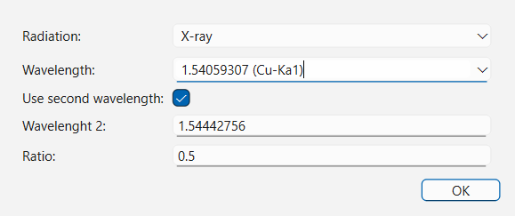
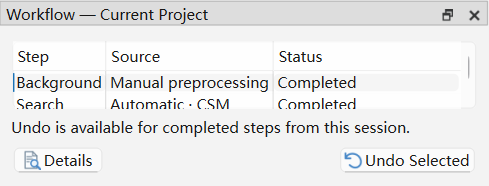
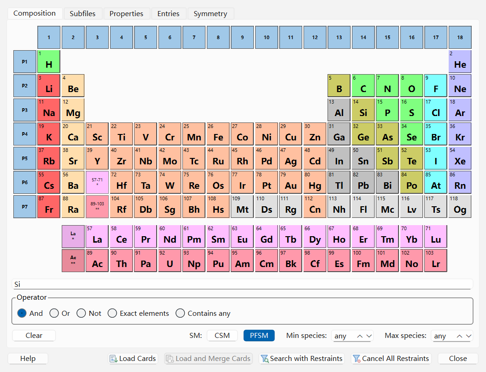
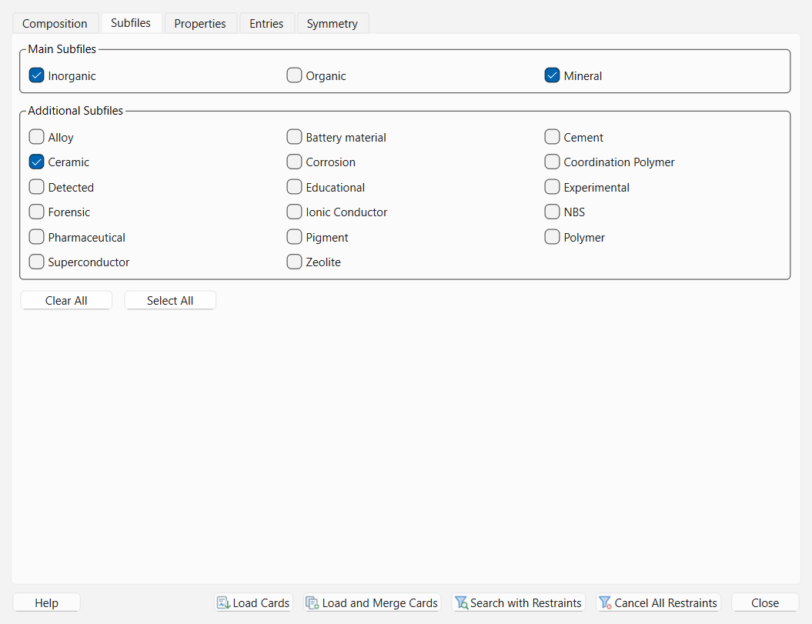
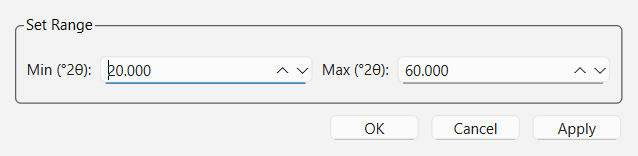
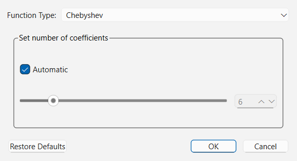
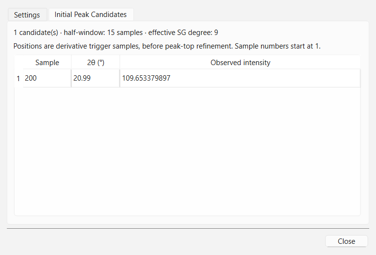
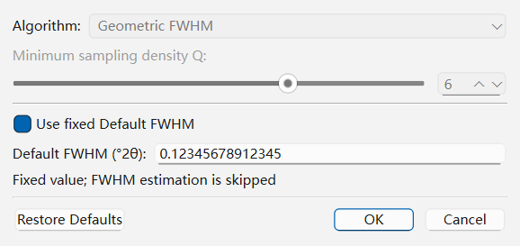
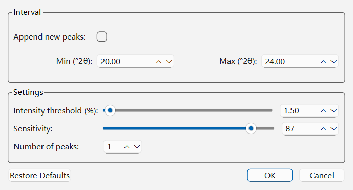
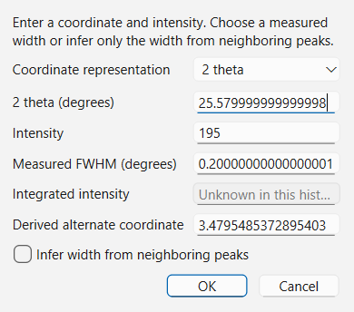

# Worked Examples

This chapter provides three complete, step-by-step walkthroughs illustrating how to use **QualPF** across typical powder diffraction scenarios:

1. **Example 1: Rapid Automated Phase Identification with PFSM** — Going from a raw diffraction pattern to identified phases with automatic prerequisite execution and live joint profile inspection.
2. **Example 2: Multi-Phase Mixture Analysis with Chemical Restraints and RIR Quantification** — Combining Periodic Table restraints, multiphase acceptance, custom RIR calibration, and report export.
3. **Example 3: Classical Peak-List Search-Match (CSM) and Low-Signal / Manual Peak Recovery** — Cropping noisy boundaries, tuning background and FWHM estimators, manually editing peaks, and running residual CSM.

---

## Example 1: Automated Profile-Fitting Search-Match (PFSM)

When analyzing an unknown crystalline powder pattern—especially when reflections overlap or when you want to avoid manual peak-picking—**PFSM** provides the most direct route.

### Step 1: Import the Pattern and Verify Wavelength

1. Select **File > Import Pattern...** (`Ctrl+I`) and open your experimental diffraction file (`.xy`, `.dat`, or powder `.cif`).
2. Select **Preprocessing > Wavelength...** (`Ctrl+W`) and confirm that the radiation kind and wavelength match your instrument (for example, `X-ray`, `Cu-Ka1` = `1.54056` Å). Click **OK**.

### Step 2: Review PFSM Options (Optional)

1. Open **Search-Match > PFSM Options...** to inspect the profile-fitting configuration for the current project.
2. Confirm that **Shift bounds** cover expected specimen displacement (default `-0.500` to `0.500` °$2\theta$), **Weighting** is set to `Auto from input`, and **Enable candidate recall** is checked on the **Candidate Recall** tab.
3. Click **OK**.

### Step 3: Run PFSM and Inspect Automatic Prerequisites

1. Select **Search-Match > Run PFSM**.
2. If you have not yet manually run Background or FWHM estimation on this pattern, QualPF automatically executes the required prerequisite steps (`Background` → `Initial Peaks` → `FWHM` using `Geometric FWHM`) and records each step in the **Workflow — Current Project** dock.

### Step 4: Inspect the Joint Trial Profile and Accept Phases

1. In the **Results List** dock, click the top-ranked candidate row.
2. Look at the central diffraction plot: QualPF overlays the candidate's calculated profile (`Joint Trial`) and updates the difference curve at the bottom of the plot.
3. Check the acceptance box next to the candidate row in the **Results List** to accept the primary phase.
4. Click the next candidate row in the **Results List** to see how a two-phase joint fit explains the remaining residual reflections, and check its box to accept the second phase.

---

## Example 2: Multi-Phase Mixture with Restraints and RIR Quantification

Suppose you are analyzing a ceramic mixture known from EDS analysis to contain **Si**, **Al**, and **O** (with **Ti** possible as a minor impurity), and you want to determine both the crystalline phases and their semi-quantitative weight percentages (`Wt.%`).

### Step 1: Configure Chemical and Subfile Restraints

1. Open **Search-Match > Restraints...** (`Ctrl+R`).
2. On the **Composition** tab:
   - Set **SM** to `PFSM` (or `CSM`).
   - Select the possible elements (`Si`, `Al`, `Ti`, `O`) on the Periodic Table using the **Or** / **Contains any** logic so only phases composed of those elements are considered.
   - Set **Minimum number of species** to `1` and **Maximum number of species** to `3`.
3. Switch to the **Subfiles** tab and check **Inorganic** and **Ceramic**.
4. Click **Search with Restraints** at the bottom of the dialog to launch the search immediately with these filters applied.

### Step 2: Verify Reflections in the `Compare` Dock and Accept Phases

1. Highlight each top candidate (`Silicon` and `Corundum`) in the **Results List** dock.
2. Switch to the **Compare** dock (**View > Compare**) to verify that every experimental reflection is accounted for within a small angular offset $\Delta 2\theta$.
3. Accept both phases into the **Quantification** panel.

### Step 3: Review or Calibrate RIR Values and Export the Report

1. Inspect the **Quantification** panel (**View > Quantification**) on the right side of the workspace. QualPF automatically computes normalized weight percentages (`Wt.%`) and displays the composition pie chart using the database Reference Intensity Ratios ($\text{RIR}$).
2. If you have an internally calibrated RIR value for one of the phases (or if a user CIF card lacks a database RIR), select that row in the **Quantification** table and click **Edit RIR...**.
3. Enter the calibrated **RIR value** and an explanatory **RIR source** note, then click **OK**. The `Wt.%` column, pie chart, and **Report** dock update immediately.
4. Switch to the **Report** dock (**View > Report**) and select **File > Print...** (`Ctrl+P`) to export a complete PDF analysis report, or click **Export CSV** in the **Quantification** panel.

---

## Example 3: Classical Search-Match (CSM) & Manual Recovery on Difficult Patterns

When working with a pattern that has noisy low-angle air scatter, weak trace-phase shoulders, or very few isolated reflections for automatic FWHM fitting, use QualPF's step-by-step data reduction and manual peak tools before running **CSM**.

### Step 1: Crop Noisy Boundary Angles and Fit the Background

1. Open **Preprocessing > Range...**, drag the left cursor past any low-angle direct-beam spill (or enter **Min** / **Max** degrees $2\theta$), and click **OK**.
2. Open **Preprocessing > Background Options...** and select `Chebyshev` (or `Filter` for undulating amorphous backgrounds). Click **OK**.
3. If the background curve under- or over-shoots near a broad peak cluster, select **Preprocessing > Add Background Points** and click on the true baseline between reflections to anchor the curve.
4. Toggle **View > Subtract Background** (`Ctrl+Shift+B`) to verify that the net baseline is flat.

### Step 2: Tune Initial Peak Search and FWHM Estimation

1. Open **Preprocessing > Initial Peak Search Options...**. If weak reflections were missed, lower **Derivative threshold** from `0.1` to `0.05` and click **OK**. Review the detected positions on the **Initial Peak Candidates** tab.
2. Open **Preprocessing > FWHM Estimation Options...**:
   - For standard scans, choose `Gaussian fit (Classical)` or `Geometric FWHM` (lowering **Minimum sampling density Q** to `3` or `4` if the angular step size is coarse).
   - If the pattern contains only overlapped multiplets where no isolated single peak exists, check **Use fixed Default FWHM** and enter your instrument's known width (e.g., `0.15` °$2\theta$). Click **OK**.

### Step 3: Extract Peaks, Add Missing Shoulders, and Run CSM

1. Open **Preprocessing > Peak Search Options...**, set **Intensity threshold (%)** to `0.80` and **Sensitivity** to `65`, and click **OK**.
2. Inspect the extracted reflections in the **Peaks** dock (**View > Peaks**).
3. If a weak minor-phase shoulder was not split automatically, right-click inside the **Peaks** dock and choose **Add Peak...** (or double-click an existing row to open **Modify table peak**), enter its position in `2 theta` or `d spacing`, keep **Infer width from neighboring peaks** checked, and click **OK**.
4. Open **Search-Match > CSM Options...**, verify that **Residual Searching** is checked, and click **OK**.
5. Select **Search-Match > Run CSM** to rank candidates against your curated peak table.

