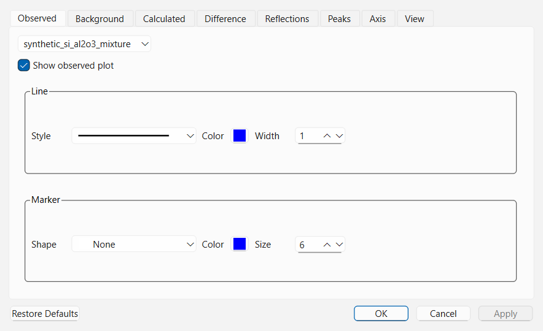

# Getting Started

This chapter introduces the **QualPF** user interface, explains every menu command, toolbar button, dock panel, and interactive plot control, and walks through importing patterns, configuring radiation wavelengths, customizing plot styles, and saving or exporting your work.

---

## Workspace Overview

When you open a diffraction pattern and run an analysis in QualPF, the main window is organized around a central interactive diffraction plot surrounded by specialized dock panels.

### The Six Main Workspace Regions

1. **Menu Bar & Toolbars (Top)** — Provides structured access to all file I/O, view toggles, data reduction steps (`Preprocessing`), phase identification tools (`Search-Match`), default workflow profiles (`Setting`), and database management (`Database`).
2. **Central Diffraction Plot** — Displays the experimental diffraction pattern, modeled background curve, extracted peak markers, accepted phase profiles, PFSM joint trial overlays, difference curve, and reference reflection stick bars.
3. **Results List Dock (Bottom-Left)** — Displays candidate phases returned by CSM or PFSM (or loaded directly via **Restraints**), complete with pagination, text filtering, FOM scores, and one-click phase acceptance.
4. **Quantification Panel (Right)** — Lists all accepted phases, manages Reference Intensity Ratio (**RIR**) values and overrides, computes normalized semi-quantitative weight percentages (`Wt.%`), and renders a live phase-fraction pie chart.
5. **Tabbed Inspection Docks (Bottom-Center)** — Houses the **Peaks** dock (experimental peak table), **Compare** dock (reflection-by-reflection alignment table), and **Report** dock (formatted analysis summary ready for printing or PDF export).
6. **Workflow — Current Project Dock** — Displays the chronological execution history of preprocessing and search-match steps in the current project, allowing you to inspect exact runtime parameters or undo (`Undo from Here`) back to an earlier state.

> **Tip:** > All dock panels in QualPF can be resized, dragged, tabbed together, floated as independent windows, or toggled on and off from the **View** menu.

---

## Complete Menu Bar Reference

### `File` Menu

| Command | Shortcut | Description |
| :--- | :--- | :--- |
| **Open Project...** | `Ctrl+O` | Opens a saved QualPF project (`.qpf`) or legacy QualX project (`.qxp`), restoring the diffraction pattern, preprocessing state, peak list, candidate list, and accepted phases. |
| **Save Project** | `Ctrl+S` | Saves the current workspace state to the active `.qpf` project file. |
| **Save Project As...** | `Ctrl+Shift+S` | Saves the current workspace state to a new `.qpf` project file. |
| **Import Pattern...** | `Ctrl+I` | Imports an experimental powder diffraction pattern from disk (supports `.xy`, `.xye`, `.dat`, `.raw`/ASCII column formats, `.cpi`, and powder `.cif` files). |
| **Export Active Pattern...** | — | Exports the currently active diffraction pattern (including preprocessed/cropped/background-subtracted working coordinates) to an external pattern file. |
| **Save Pattern Image...** | — | Exports the central diffraction plot as a publication-quality raster image (`.png`, `.jpg`, `.bmp`, `.tif`) with configurable dimensions and DPI. |
| **Print...** | `Ctrl+P` | Prints either the central diffraction plot or the formatted **Report** dock (can also print to PDF). |
| **Recent Files** | — | Quickly reopens recently accessed patterns and projects. |
| **Quit** | `Ctrl+Q` | Closes QualPF (prompts to save if the active project has unsaved modifications). |

### `View` Menu

| Command | Shortcut | Description |
| :--- | :--- | :--- |
| **Plot Style...** | — | Opens the **Plot Style** dialog to customize colors, line widths, scatter markers, and background fills for all plot layers. |
| **Change Abscissa** | — | Switches the horizontal axis of the central plot between **$2\theta$ (`2Theta`)**, **$d$-spacing (`d`)**, **$1/d$**, and **$1/d^2$**. |
| **Log Intensity Scale** | `Ctrl+L` | Toggles the vertical intensity axis between linear and logarithmic ($log_{10}$) scaling to help inspect weak reflections alongside strong peaks. |
| **Intensity Counts** | `Ctrl+N` | Toggles vertical axis scaling between raw intensity counts and normalized relative intensity ($0\text{–}100\%$). |
| **Subtract Background** | `Ctrl+Shift+B` | Toggles the central plot between the raw/working pattern with overlaid background curve and the **net background-subtracted pattern**. |
| **Reset View** | `Ctrl+0` | Resets plot zoom and pan to fit the full calculation range. |
| **Peaks / Results List / Compare / Quantification / Report / Workflow — Current Project** | — | Shows or hides each corresponding dock widget. |

### `Preprocessing` Menu

| Command | Shortcut | Description |
| :--- | :--- | :--- |
| **Wavelength...** | `Ctrl+W` | Opens the **Set Wavelength Radiation** dialog to configure incident radiation kind and $\lambda_1 / \lambda_2$ wavelengths. |
| **Range...** | — | Opens the **Range** dialog to crop the calculation interval $[\text{Min } 2\theta, \text{Max } 2\theta]$. |
| **Background** | `Ctrl+B` | Runs automatic background estimation immediately using the active project background parameters. |
| **Background Options...** | — | Opens the **Background** dialog to select and configure Chebyshev, Polynomial, Cosine Fourier, Cubic Spline, Bezier Spline, Bruckner Filter, or None. |
| **Add Background Points** | — | Enables interactive click-to-add background control points on the central plot. |
| **Delete Background Points** | — | Enables interactive click-to-delete background control points on the central plot. |
| **Clear Background Points** | — | Removes all manually added background control points and restores default control points. |
| **Initial Peak Search** | — | Runs Savitzky-Golay third-derivative initial peak candidate detection immediately. |
| **Initial Peak Search Options...** | — | Opens the **Initial Peak Search Options** dialog to tune the derivative threshold, SG window, and polynomial degree, and inspect detected candidates. |
| **FWHM Estimation** | — | Runs representative FWHM estimation immediately (`Gaussian fit`, `Geometric FWHM`, or `Fixed Default FWHM`). |
| **FWHM Estimation Options...** | — | Opens the **FWHM Estimation Options** dialog to choose the FWHM algorithm and sampling density $Q$ or fixed width. |
| **Peak Search** | `Ctrl+K` | Runs formal experimental peak extraction immediately using current **Peak Search Options**. |
| **Peak Search Options...** | — | Opens the **Peak Search Options** dialog to configure angular interval, intensity threshold, sensitivity, and peak count limit. |
| **Add Peak** | — | Activates interactive peak addition on the diffraction plot (supports standard and inferred-width peaks). |
| **Delete Peak** | — | Activates interactive peak deletion on the diffraction plot. |
| **Smoothing...** | — | Opens the **Smoothing** dialog to apply Savitzky-Golay or Adjacent-Averaging smoothing. |
| **K-alpha2 Stripping** | — | Strips $K\alpha_2$ doublet contributions from the pattern when a dual-wavelength radiation source is configured. |
| **Restart Preprocessing** | — | Reverts all preprocessing modifications on the pattern and restores the original imported observations. |

### `Search-Match` Menu

| Command | Shortcut | Description |
| :--- | :--- | :--- |
| **Run CSM** | — | Executes Classical Peak-List Search-Match against all enabled databases. |
| **CSM Options...** | — | Opens **CSM Options** to configure FOM weights, $\Delta 2\theta$ tolerance, residual searching, and result limits. |
| **Run PFSM** | — | Executes Profile-Fitting Search-Match (automatically running any missing prerequisite steps first). |
| **PFSM Options...** | — | Opens **PFSM Options** to configure shift bounds, weighting policy, worker threads, template cache, and **Candidate Recall** limits. |
| **Restraints...** | `Ctrl+R` | Opens the 5-tab **Restraints** dialog (`Composition`, `Subfiles`, `Properties`, `Entries`, `Symmetry`) to filter candidates or browse cards directly. |
| **Cancel All Restraints** | — | Clears all active chemical, subfile, property, entry, and symmetry restraints. |
| **Next Page / Previous Page** | — | Navigates through paginated candidate results in the **Results List** dock. |

### `Setting`, `Database`, and `Help` Menus

- **`Setting` Menu** (`Preprocessing...`, `CSM...`, `PFSM...`, `Peak Search...`) — Opens the **Setting — Defaults for New Projects** dialog at the corresponding workflow profile. See [Workflow Settings and Project History](../settings.md).
- **`Database` Menu** (`Manage Databases...`) — Opens the **Manage Databases** dialog to register, enable, rename, create, or delete reference databases. See [Database Installation](../database-installation.md).
- **`Help` Menu** (`QualPF Manual`, `Check for Updates...`, `About QualPF`) — Opens this manual, checks for software updates, or displays version and license details.

---

## Radiation and Wavelength Configuration

Before running peak search, $K\alpha_2$ stripping, or search-match, verify that the pattern's incident radiation matches your diffractometer setup by selecting **Preprocessing > Wavelength...** (`Ctrl+W`).

### Parameter Reference: `Set Wavelength Radiation` Dialog

| Parameter | Default | Options / Range | Role and Effect |
| :--- | :--- | :--- | :--- |
| **Radiation** | `X-ray` | `X-ray`, `Neutron`, `Electron` | Specifies the physical diffraction probe. Recorded in project metadata and used when interpreting scattering factors in structure imports. |
| **Wavelength** ($\lambda_1$ Preset) | `Cu-Ka1` | `Cu-Ka1` (`1.54056` Å), `Cr-Ka1` (`2.28973` Å), `Fe-Ka1` (`1.93604` Å), `Co-Ka1` (`1.78900` Å), `Mo-Ka1` (`0.70932` Å), `User Defined` | Selects the primary monochromatic wavelength $\lambda_1$ used in Bragg's law ($\lambda = 2d \sin\theta$) to convert between $2\theta$ angles and $d$-spacings. Choosing `User Defined` unlocks the numeric wavelength field. |
| **Primary Wavelength Value** | `1.54056` Å | `0.0` – `5.0` Å | Numeric value of $\lambda_1$ in Ångströms. Automatically populated for standard X-ray anodes or manually editable when `User Defined` is selected. |
| **Add second wavelength** | Unchecked | Checked / Unchecked | Enables a bichromatic ($K\alpha_1 + K\alpha_2$) radiation model. Required if you intend to run **Preprocessing > K-alpha2 Stripping** on laboratory X-ray data collected without a primary monochromator. |
| **Wavelength 2** ($\lambda_2$) | `1.54439` Å (for Cu) | `0.0` – `5.0` Å | Secondary wavelength $\lambda_2$ in Ångströms. Automatically filled with the corresponding $K\alpha_2$ wavelength when a standard anode is selected (`Cu`: `1.54439` Å, `Cr`: `2.29361` Å, `Fe`: `1.93998` Å, `Co`: `1.79285` Å, `Mo`: `0.71359` Å). |
| **I(lambda2)/I(lambda1)** | `0.5` | `0.0` – `1.0` | Intensity ratio of the secondary wavelength relative to the primary wavelength (typically `0.5` for characteristic X-ray $K\alpha_2 / K\alpha_1$ doublets). Used by Rachinger $K\alpha_2$ stripping and doublet profile calculations. |

---

## Interactive Central Plot Controls

The central diffraction plot supports fast mouse and keyboard navigation:

- **Zoom into a Box Region**: Left-click and drag a rectangle over the plot area to zoom into the selected $2\theta$ and intensity window.
- **Zoom Undo / Redo**: Right-click or use **View > Reset View** (`Ctrl+0`) to return to the full pattern range.
- **Mouse Wheel Zoom & Pan**: Scroll the mouse wheel over an axis or plot canvas to zoom smoothly; drag axes to pan horizontally or vertically.
- **Cursor Readout**: Moving the mouse over the plot displays live cursor coordinates ($2\theta$, $d$-spacing, and intensity) in the status bar and highlights nearby candidate/experimental reflections.
- **Reflection Stick Bars**: Selecting a candidate phase in the **Results List** plots its reference reflections as vertical bars scaled by the phase scale factor. In PFSM mode, it also overlays the **Joint Trial** calculated profile and difference trace.

### Customizing Visual Appearance (`View > Plot Style...`)

Select **View > Plot Style...** to customize how every curve and marker layer is rendered on screen and in exported images.

| Plot Style Control | Role and Options |
| :--- | :--- |
| **Graph Item Selector** | Selects which plot layer to style (Experimental Pattern, Background Curve, Net Pattern, Peak Markers, Candidate Reflections, Accepted Phase Curves, PFSM Joint Fit, or Difference Plot). |
| **Line Style (`Style`, `Width`, `Color`)** | Configures the pen style (`Solid`, `Dash`, `Dot`, `DashDot`, `None`), line thickness in pixels, and stroke color. |
| **Marker Style (`Shape`, `Size`, `Color`)** | Configures data-point scatter markers (`None`, `Dot`, `Cross`, `Plus`, `Circle`, `Disc`, `Square`, `Diamond`, `Star`, `Triangle`, etc.) and marker size. |
| **Canvas Background (`ColorWidget`)** | Sets the plot background fill (`White`, `Black`, `Flat Color`, or `Horizontal` / `Vertical` / `Diagonal` / `Radial` gradients). |

---

## Saving Projects and Exporting Data

### Saving and Reopening Projects (`.qpf` / `.qxp`)

- **File > Save Project** (`Ctrl+S`) / **Save Project As...** (`Ctrl+Shift+S`) writes a self-contained `.qpf` project file containing:
  - The original imported diffraction pattern and its provenance metadata;
  - The current working pattern, angular calculation range, background points/curve, and FWHM state;
  - The extracted and manually edited experimental peak list;
  - The complete workflow step history (**Workflow — Current Project**);
  - Active search-match candidates, accepted phases, RIR overrides, and plot style preferences.
- **File > Open Project...** (`Ctrl+O`) loads both native `.qpf` projects and legacy QualX `.qxp` project files.

### Exporting Patterns, Images, CSVs, and PDF Reports

1. **Exporting the Active Pattern (`File > Export Active Pattern...`)**: Writes the active diffraction curve (including any range cropping, smoothing, $K\alpha_2$ stripping, or background subtraction currently applied) to a two-column ASCII/XY pattern file.
2. **Saving Plot Images (`File > Save Pattern Image...`)**: Opens the **Image Settings** dialog where you can specify pixel width, pixel height, and resolution (DPI) before saving a `.png`, `.jpg`, `.bmp`, or `.tif` figure.
3. **Exporting Tables to CSV**:
   - In the **Results List** dock, right-click or use the export action to export candidate rows.
   - In the **Quantification** panel, click **Export CSV** to save the accepted phase table, RIR sources, and calculated weight percentages (`Wt.%`).
4. **Printing or Exporting a PDF Report**: Switch to the **Report** dock to inspect the complete formatted summary (pattern settings, peak list, search restraints, accepted phases, reflections, and quantitative breakdown), then select **File > Print...** (`Ctrl+P`) to print or save as a PDF document.
