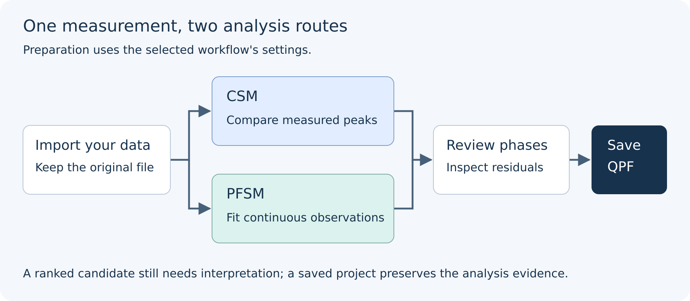

# Introduction to Phase Identification in QualPF

Qualitative phase identification from powder diffraction data determines which crystalline phases are present in an unknown sample by comparing its measured diffraction pattern against a reference database of known substances. Once the constituent phases have been identified and accepted, semi-quantitative analysis estimates their relative weight fractions.

**QualPF** provides an integrated scientific environment that supports both classical peak-list matching (**CSM**) and direct profile-fitting search-match (**PFSM**).

---

## End-to-End Analysis Architecture

---

## The Two Stages of Powder Diffraction Analysis

### Stage 1: Data Reduction (`Preprocessing` Menu)

Experimental powder diffraction patterns contain instrumental and sample artifacts alongside Bragg reflections:
- **Low- or high-angle noise** from beam spill, air scatter, or detector edge cutoffs (**Preprocessing > Range**).
- **Continuous background intensity** from fluorescence, incoherent scattering, sample holders, or amorphous content (**Preprocessing > Background Options**).
- **Peak broadening** governed by diffractometer optics and crystallite size/strain (**Preprocessing > FWHM Estimation Options**).
- **$K\alpha_1 / K\alpha_2$ doublet splitting** in laboratory X-ray instruments without primary monochromators (**Preprocessing > K-alpha2 Stripping**).
- **Counting noise** in rapid scans (**Preprocessing > Smoothing**).

In QualPF, data reduction transforms raw experimental data into a clean **working pattern** and/or **experimental peak list**. Every data-reduction operation is tracked in the project's workflow provenance (**Workflow — Current Project** dock) and can be inspected. Parameter changes invalidate affected results after confirmation; undo requires a retained snapshot from the current session.

### Stage 2: Search-Match & Phase Acceptance (`S&M` Menu)

During search-match, QualPF queries the single selected reference database (filtered by any active **Restraints**) and ranks candidate phases by a **Figure of Merit (FOM)**. You then review the top candidates using synchronized views:
1. **Results List** dock — sortable candidate table showing FOM, scale factor, peak-position score, intensity score, chemical formula, and quality mark.
2. **Central Diffraction Plot** — overlays candidate stick reflections ($d$/$2\theta$ bars) and, in PFSM mode, the live **Joint Trial** profile and difference curve.
3. **Compare** dock (CSM) — angle/intensity pairs for experimental peaks, associated reference reflections and unmatched reflections of the selected card. PFSM uses its joint-profile diagnostics.
4. **Quantification** panel — tracks accepted phases, calculates **Reference Intensity Ratio (RIR)** weight percentages, and displays a live composition pie chart.

---

## Choosing Between CSM and PFSM

QualPF offers two distinct search-match engines. Understanding how they consume experimental data helps you select the best route for your sample:

| Characteristic | CSM (`S&M > CSM (Classical SM)`) | PFSM (`S&M > PFSM`) |
| :--- | :--- | :--- |
| **Primary Experimental Input** | A real continuous spectrum with a calculation range, plus a compatible experimental peak table extracted, imported or manually edited for that pattern. | Continuous **working diffraction profile** plus estimated **background** and one common representative **FWHM**. |
| **Prerequisite Steps** | Requires a non-empty reusable peak table; missing preparation is run automatically. A peak table alone cannot replace the continuous spectrum used by the score. | Requires a valid pattern with retained original-signal provenance, a background curve and representative FWHM. Automatically executes missing Background and geometric FWHM preparation; a compatible manual or fixed width can be supplied. |
| **Handling of Peak Overlap** | Relies on accurate peak picking; severe peak overlap in low-symmetry or multi-phase mixtures can hide weak shoulders or shift centroids. | Fits complete multi-reflection phase templates directly against the profile, providing joint trial profiles for assessing overlapping peaks; this does not guarantee correct identification or uniquely determined phase amounts. |
| **Specimen Displacement / Zero Shift** | Controlled via angular match tolerance **$\Delta 2\theta$** (manual or automatic). | Fits a constant additive angular shift for each phase within **Shift bounds** (default `-0.500` to `+0.500` °$2\theta$); it does not fit an angle-dependent displacement law. |
| **Multi-Phase Identification** | Uses **Residual Searching** to attenuate matched experimental peaks as phases are accepted or iterated. | Uses **Joint Multiphase Profile Fitting**: selecting a candidate previews a joint fit of all accepted phases plus the trial candidate, and accepting a phase updates the joint profile and residual curve. |
| **Best Suited For** | Continuous patterns with well-resolved, curated peaks and classical stored-line screening. | Complex multi-phase mixtures, patterns with severe peak overlap, broad or weak reflections, and quantitative profile-guided phase verification. |

---

## Next Steps

- Take a guided tour of the QualPF interface in [Getting Started](getting-started.md).
- Learn how default workflow parameters and project step provenance work in [Workflow Settings and Project History](../settings.md).
- Walk through complete step-by-step analyses in [Worked Examples](examples.md).
