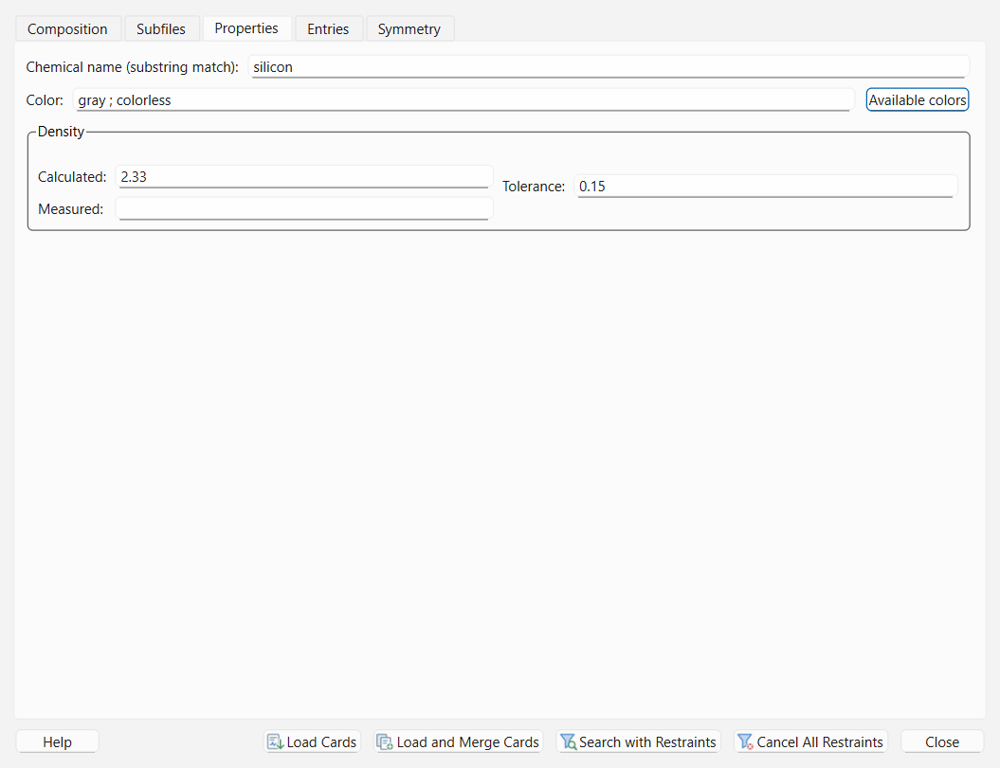
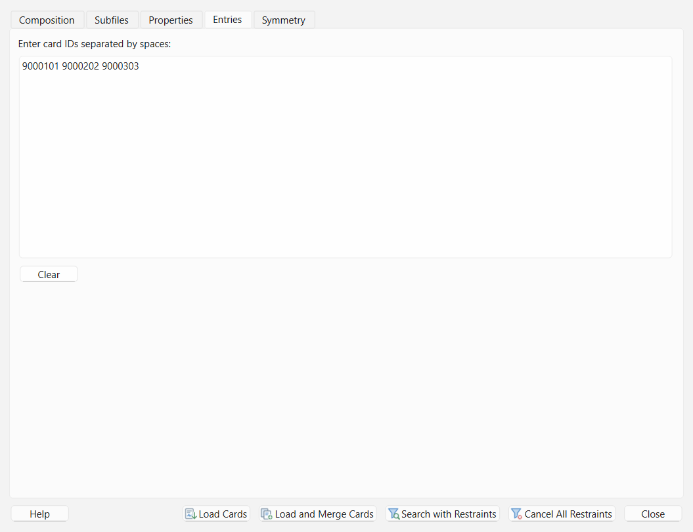
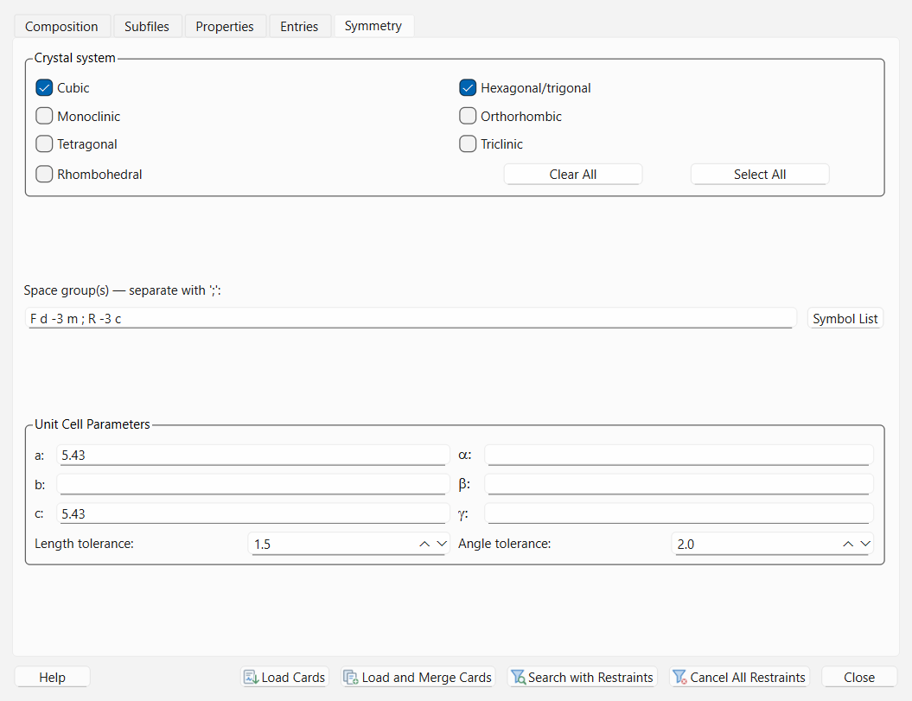

# Restraints and Database Card Browsing

In phase identification of minerals, ceramics, alloys, and synthetic materials, you often possess prior chemical or crystallographic knowledge about the specimen—such as EDS/XRF elemental composition, material class, density, or unit-cell symmetry. The **Restraints** dialog (**Search-Match > Restraints...**, `Ctrl+R`) lets you translate that prior knowledge into fast SQL database filters applied during **CSM** or **PFSM**, or browse matching reference cards directly without running a search.

---

## Overview of the `Restraints` Dialog

Open **Search-Match > Restraints...** (`Ctrl+R`) to access the five-tab **Restraints** window:
1. **Composition** — Periodic Table elemental logic and chemical species count bounds.
2. **Subfiles** — Database subfile category filters (Inorganic, Mineral, Metal & Alloy, Ceramic, etc.).
3. **Properties** — Chemical/mineral name substring, color, and crystal density filters.
4. **Entries** — Direct lookup by space-separated database card IDs.
5. **Symmetry** — Crystal system, space-group symbol, and unit-cell parameter ($a, b, c, \alpha, \beta, \gamma$) restraints.

> **Note:** > All five restraint tabs combine with **logical AND**: if you configure a chemical restraint on the **Composition** tab and check `Inorganic` on the **Subfiles** tab, a database entry must satisfy **both** conditions to pass screening.

---

## Tab 1: `Composition` (Periodic Table & Species Count)

### How to Build Chemical Restraints on the Periodic Table

You can specify elemental restraints either by clicking element buttons on the interactive Periodic Table (left-click cycles selection state) or by selecting an operator mode (`And`, `Or`, `Not`, `Exact elements`, `Contains any`) and clicking elements to build an expression in the **Formula / Restraint Expression** bar at the top.

### Parameter Reference: `Composition` Tab

| Control / Parameter | Default | Options / Range | Role and Effect |
| :--- | :--- | :--- | :--- |
| **Formula / Restraint Expression Bar** | Empty | Boolean element expression | Displays the active elemental filter expression (for example, `Si AND O OR (Al)`). Can be edited via Periodic Table clicks or cleared with **Cancel**. |
| **And** (Must Be Present) | Mode button | Element group | Requires all selected elements in the group to be present in the candidate phase's chemical formula. |
| **Or** (Possible) | Mode button | Element group | Allows any of the selected elements in the group to be present. |
| **Not** (Excluded) | Mode button | Element group | Excludes any database phase containing one or more of the selected elements. |
| **Exact elements** | Mode button | Element set | Restricts results to phases composed **exclusively** of the exact set of selected elements (no additional elements permitted). |
| **Contains any** | Mode button | Element set | Matches phases that contain at least one element from the selected set (and excludes elements not compatible with the filter). |
| **Wildcard Category Buttons** | Unselected | Group toggles | Quickly selects or excludes entire chemical families on the Periodic Table (such as Alkali Metals, Alkaline Earths, Transition Metals, Lanthanides, Actinides, Halogens, or Noble Gases). |
| **Cancel** (Formula bar button) | Button | Action | Clears only the current composition formula expression on the **Composition** tab. |
| **SM (`CSM` / `PFSM`)** | `CSM` (or active workflow) | `CSM`, `PFSM` | Selects which search-match engine will be launched if you click **Search with Restraints** at the bottom of the dialog. This selection stays synchronized across all five tabs. |
| **Minimum number of species** | `any` (`0`) | `0` (`any`) – `99` | Minimum number of distinct chemical elements (species) that a candidate phase must contain. For example, setting `Min = 2` and `Max = 2` restricts results to binary compounds. |
| **Maximum number of species** | `any` (`0`) | `0` (`any`) – `99` | Maximum number of distinct chemical elements that a candidate phase may contain (`0` means `any`, i.e., no upper bound). |

---

## Tab 2: `Subfiles`

Switch to the **Subfiles** tab to filter candidate cards by their curated database classification.

### Parameter Reference: `Subfiles` Tab

| Group | Available Checkboxes | Role and Effect |
| :--- | :--- | :--- |
| **Main Subfiles** | `Inorganic`, `Organic`, `Metal & Alloy` | Filters phases by primary material domain. When multiple subfile checkboxes are checked, cards belonging to **any** of the checked subfiles are retained. |
| **Additional Subfiles** | `Mineral`, `NBS`, `Forensic`, `Corrosion`, `Common Phases`, `Educational`, `High Pressure`, `Superconductor`, `Zeolite`, `Ceramic`, `Cement`, `Explosive`, `Pharmaceutical`, `Polymer`, `Detergent`, `Pigment & Dye`, `calculated from ICSD` | Filters phases by specialized application or provenance subfile categories indexed in ICDD PDF-2 or COD/User databases. |

---

## Tab 3: `Properties` (Chemical Name, Color, Density)

Switch to the **Properties** tab to filter phases by name, physical color, or crystal density.

### Parameter Reference: `Properties` Tab

| Parameter / Control | Default | Format / Range | Role and Effect |
| :--- | :--- | :--- | :--- |
| **Chemical name** | Empty | Semicolon-separated substrings (e.g., `silicon ; oxide`) | Retains cards whose chemical name or mineral name contains the specified substring(s) (case-insensitive). Multiple terms separated by `;` are matched flexibly. |
| **Color** | Empty | Semicolon-separated color tokens (e.g., `gray ; colorless`) | Filters cards by recorded mineral/compound color description. |
| **Available colors...** | Button | Interactive picker dialog | Opens a list of standardized color descriptors present in the database; selected colors are inserted into the **Color** field separated by `;`. |
| **Density — Calculated** | Empty | Positive number ($\text{g/cm}^3$) | Target X-ray/crystallographic calculated density $D_x$. Matches cards within $[\text{Calculated} - \text{Tolerance}, \text{Calculated} + \text{Tolerance}]$. |
| **Density — Measured** | Empty | Positive number ($\text{g/cm}^3$) | Target experimentally measured density $D_m$. Matches cards within $[\text{Measured} - \text{Tolerance}, \text{Measured} + \text{Tolerance}]$. |
| **Density — Tolerance** | `0.1` | Positive number ($\text{g/cm}^3$) | Half-width $\pm \Delta D$ of the allowed density interval around **Calculated** and/or **Measured** density. |

---

## Tab 4: `Entries` (Direct Card ID Lookup)

Switch to the **Entries** tab when you know the specific database card number(s) (for example, COD seven-digit IDs such as `9000101` or ICDD PDF card numbers) that you want to inspect or test.

### Parameter Reference: `Entries` Tab

| Parameter | Default | Format | Role and Effect |
| :--- | :--- | :--- | :--- |
| **Space-separated entry IDs** | Empty | Whitespace-separated card IDs (e.g., `9000101 9000202 9000303`) | Restricts database queries strictly to the listed entry IDs. Particularly useful with **Load Cards** or **Load and Merge Cards** to pull specific reference cards directly into the **Results List** dock for overlay on the plot. |

---

## Tab 5: `Symmetry` (Crystal System, Space Group, Unit Cell)

Switch to the **Symmetry** tab to constrain candidates by crystallographic symmetry or lattice dimensions.

### Parameter Reference: `Symmetry` Tab

| Group | Parameter / Control | Default | Range / Options | Role and Effect |
| :--- | :--- | :--- | :--- | :--- |
| **Crystal system** | `Cubic`, `Hexagonal/Trigonal`, `Tetragonal`, `Orthorhombic`, `Monoclinic`, `Triclinic`, `Unknown` | All unchecked (no filter) | Checkboxes | Retains cards belonging to any of the checked crystal systems. Checking `Hexagonal/Trigonal` matches both hexagonal and trigonal/rhombohedral entries. |
| **Space group(s)** | **Space group text box** | Empty | Semicolon-separated Hermann-Mauguin symbols (e.g., `F d -3 m ; R -3 c`) | Filters candidates by space-group symbol. |
| **Space group(s)** | **Symbol List...** | Button | Interactive picker dialog | Opens a searchable list of standard crystallographic space-group symbols and inserts chosen symbols into the text box separated by `;`. |
| **Unit Cell Parameters** | **a (Å)**, **b (Å)**, **c (Å)** | Empty | `0.0` – `100.0` Å | Target unit-cell edge lengths. Any populated edge length restricts candidates to $[L - \Delta L, L + \Delta L]$ using **Length tolerance**. Leave blank to ignore that axis. |
| **Unit Cell Parameters** | **Alpha (°)**, **Beta (°)**, **Gamma (°)** | Empty | `0.0` – `180.0`° | Target unit-cell interaxial angles ($\alpha, \beta, \gamma$). Any populated angle restricts candidates to $[\theta - \Delta\theta, \theta + \Delta\theta]$ using **Angle tolerance**. |
| **Unit Cell Parameters** | **Length tolerance (Å)** | `1.5` | `0.0` – `100.0` Å | Allowed $\pm$ tolerance in Ångströms for populated unit-cell lengths $a$, $b$, and $c$. |
| **Unit Cell Parameters** | **Angle tolerance (°)** | `2.0` | `0.0` – `180.0`° | Allowed $\pm$ tolerance in degrees for populated unit-cell angles $\alpha$, $\beta$, and $\gamma$. |

---

## Dialog Action Buttons (Bottom Bar of `Restraints`)

The bottom toolbar of the **Restraints** dialog provides five workflow actions:

| Button | When Enabled | Role and Behavior |
| :--- | :--- | :--- |
| **Load Cards** | When at least one restraint is active | Queries the active databases using the current restraints **without running CSM or PFSM scoring** and replaces the **Results List** dock with all matching reference cards. Ideal for browsing reference patterns or manually accepting a known phase. |
| **Load and Merge Cards** | When at least one restraint is active and the **Results List** already contains cards | Queries the active databases using the current restraints and **appends/merges** the matching reference cards into the existing **Results List** dock without discarding previous search-match results. |
| **Search with Restraints** | When an experimental pattern (and peak list for CSM) is ready and restraints are configured | Closes the dialog and immediately executes **Run CSM** or **Run PFSM** (according to the **SM: CSM / PFSM** toggle on the **Composition** tab) with the configured restraints applied. |
| **Cancel All Restraints** | Always | Clears every field and checkbox across all five tabs (`Composition`, `Subfiles`, `Properties`, `Entries`, and `Symmetry`). Also accessible directly from **Search-Match > Cancel All Restraints**. |
| **Close** | Always | Closes the **Restraints** dialog while keeping the configured restraints active in the session for subsequent **Run CSM** or **Run PFSM** commands. |
