# Executing Search-Match, Phase Acceptance, and Quantification

This chapter provides a complete parameter and workflow reference for configuring **CSM Options** and **PFSM Options**, evaluating candidate phases in the **Results List** and **Compare** docks, inspecting live **PFSM Joint Trial** profiles, accepting phases into the working solution, performing **Reference Intensity Ratio (RIR)** semi-quantitative analysis, and generating the final **Report**.

---

## Configuring Classical Search-Match (`S&M > CSM Options...`)

Select **S&M > CSM Options...** to configure the Figure of Merit (FOM) weights, angular matching window, and screening rules used when you run **S&M > CSM (Classical SM)**.

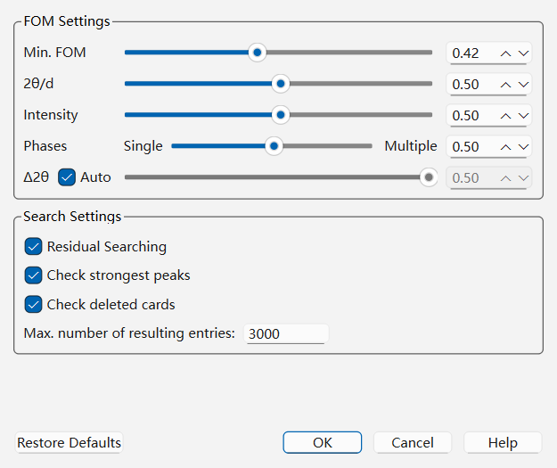

### Parameter Reference: `CSM Options` Dialog

| Group | Parameter | Default | Range / Options | Role and Effect |
| :--- | :--- | :--- | :--- | :--- |
| **FOM Settings** | **Min. FOM** | `0.35` | `0.00` – `1.00` | Minimum ranking score for inclusion in the **Results List** dock. Lower values retain weaker matches for inspection; higher values are more selective. FOM is not a probability or calibrated identification confidence. |
| **FOM Settings** | **2θ/d** | `0.50` | `0.00` – `1.00` (slider & spinbox) | Relative weight assigned to angular position agreement ($\Delta 2\theta / \Delta d$) between experimental peaks and reference reflections. Increase (e.g., to `0.75`) when peak positions are well calibrated but preferred orientation distorts intensities. |
| **FOM Settings** | **Intensity** | `0.50` | `0.00` – `1.00` (slider & spinbox) | Relative weight assigned to reflection intensity agreement. Decrease (e.g., to `0.20`) if strong texture/preferred orientation is present in the specimen. |
| **FOM Settings** | **Phases (`Single` ↔ `Multiple`)** | `0.50` | `0.00` (`Single`) – `1.00` (`Multiple`) | Adjusts the FOM penalty for unmatched experimental peaks vs. unmatched reference reflections. Move toward **Single (`0.00`)** when the sample is expected to be a single pure phase; move toward **Multiple (`1.00`)** when identifying multiple phases in a complex mixture. |
| **FOM Settings** | **Δ2θ (°)** & **Auto** | `0.08` (`Auto` checked) | `0.01` – `0.50`° | Maximum angular discrepancy allowed between an experimental peak and a reference reflection to count as a match. When **Auto** is checked, QualPF automatically derives $\Delta 2\theta$ from the pattern's experimental peak widths. Uncheck **Auto** to specify a fixed angular window (e.g., `0.12`° or `0.20`° when specimen displacement is present). |
| **Search Settings** | **Residual Searching** | Checked | Checked / Unchecked | When checked, accepting a phase (or running residual search) subtracts the matched intensity contributions from the working experimental peak list (`intensity`) while preserving the original intensities (`intensityOrig`), allowing minor phases to rank at the top. |
| **Search Settings** | **Check strongest peaks** | Checked | Checked / Unchecked | Requires at least one of the three strongest reflections of a reference card to match an experimental peak during fast database screening. Uncheck only if severe preferred orientation completely suppresses a phase's strongest reflection. |
| **Search Settings** | **Check deleted cards** | Checked | Checked / Unchecked | Checks deletion status and excludes cards marked deleted. Unchecking disables that exclusion. |
| **Search Settings** | **Max. number of resulting entries** | `3000` | Positive integer | Maximum number of candidate rows retained in the **Results List** dock after ranking. |

---

## Configuring Profile-Fitting Search-Match (`S&M > PFSM Options...`)

Select **S&M > PFSM Options...** to configure the profile-fitting search engine, specimen-shift bounds, observation weighting, parallel execution, and multi-channel **Candidate Recall** limits used by **S&M > PFSM**.

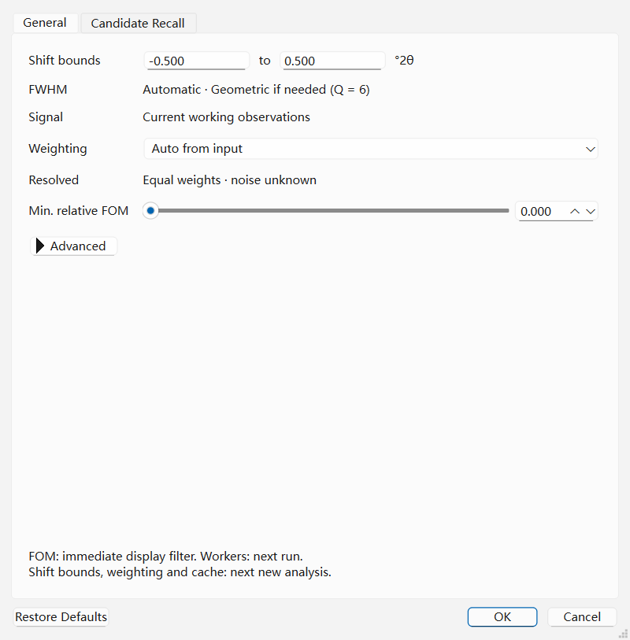

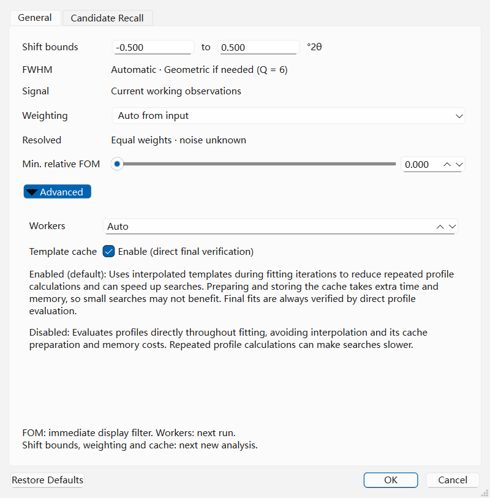

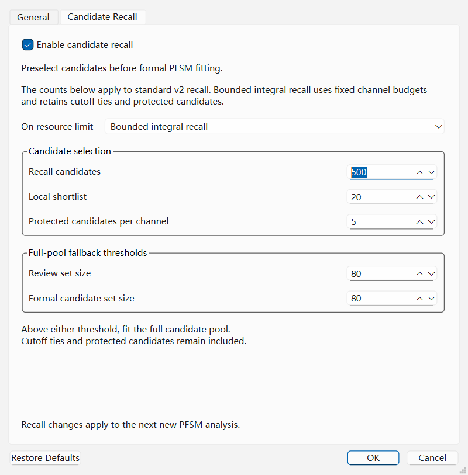

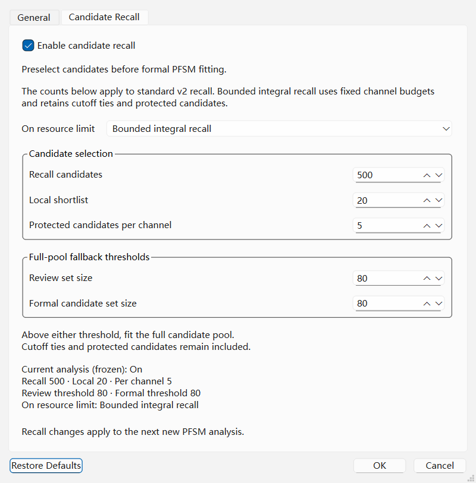

### Parameter Reference: `PFSM Options` — `General` Tab

| Section | Parameter / Readout | Default | Range / Options | Role and Effect |
| :--- | :--- | :--- | :--- | :--- |
| **Shift bounds** | **Lower (°2θ)** / **Upper (°2θ)** | `-0.500` / `+0.500` | Finite values with $\text{Lower} \le \text{Upper}$ | Defines the allowed angular shift interval $[\Delta 2\theta_{\min}, \Delta 2\theta_{\max}]$ over which PFSM optimizes each candidate phase's position to compensate for specimen displacement, transparency, or zero-point offset. Narrowing to `[-0.15, +0.15]` speeds up search on well-aligned diffractometers; widening to `[-0.80, +0.80]` accommodates unaligned capillary or in-situ stages. |
| **Provenance Readouts** | **FWHM** | Read-only status | Current project FWHM state | Displays the active representative peak width and its provenance (e.g., `0.200 deg 2theta (Geometric, Q = 6)` or `Will run prerequisite FWHM estimation`). |
| **Provenance Readouts** | **Signal** | Read-only status | Current working observations | Identifies the signal being fitted; the separate **Resolved** readout reports the selected weighting. |
| **Weighting** | **Weighting policy** | `Auto from input` | `Auto from input`, `Equal weights` | Determines the least-squares observation weights $w_i$ across the diffraction profile. `Auto from input` uses compatible attested noise, including inverse-variance or Poisson weights, when supplied. Current text/CIF imports do not attest those statistics, so ordinary GUI imports resolve to `Equal weights` ($w_i = 1$). Transformed observations do not inherit raw-count statistics. Choosing `Equal weights` forces uniform weighting regardless of input provenance. |
| **Weighting** | **Resolved** | Read-only status | Active weight formula | Explicitly reports the resolved weighting mode that PFSM will execute (`Poisson counting weights` vs. `Equal weights`). |
| **Filtering** | **Min. relative FOM** | `0.000` | `0.000` – `1.000` | Filters displayed candidates by relative FOM without discarding canonical fit evidence. |
| **Advanced** | **Workers (0 = Auto)** | `0` | Nonnegative integer | Number of parallel CPU worker threads used during PFSM candidate screening and profile fitting (`0` selects workers automatically). |
| **Advanced** | **Template cache** | Checked | Checked / Unchecked | Caches expanded fixed Intermediate Lorentzian reference profile templates in RAM across searches and phase-acceptance steps on the active pattern. Keep checked for fast interactive phase acceptance. |

> **Current-project scope:** FOM changes the display immediately; workers apply to
> the next run. Shift bounds, weighting, cache and recall inputs belong to a frozen
> analysis. Changing those project settings requires confirmation before dependent
> results are removed; the dialog also displays the current frozen configuration.

### Parameter Reference: `PFSM Options` — `Candidate Recall` Tab

When searching large databases (such as the full 500,000+ entry COD), PFSM uses a multi-stage, multi-channel **Candidate Recall** pipeline to identify promising candidates before running full nonlinear multiphase profile fitting:

| Parameter | Default | Range / Options | Role and Effect |
| :--- | :--- | :--- | :--- |
| **Enable candidate recall** | Checked | Checked / Unchecked | Prescreens before formal fitting. Disabled evaluates the candidate pool directly, subject to resource checks. Approximate recall can omit a phase. |
| **On resource limit** | `Bounded integral recall` | Bounded integral or full-pool fitting | Selects the alternative when standard v2 recall hits its resource route. Bounded integral uses fixed channel budgets, ties and protection; the five standard-v2 counts below do not define its funnel. |
| **Recall candidates** | `500` | Positive integer | Target from alternating original/residual channels; cutoff ties and numerical protection are additional. |
| **Local shortlist** | `20` | Positive, at most recall target | Top-K before and after local review. This is not a count per angular window. |
| **Protected candidates per channel** | `5` | Positive, at most local shortlist | Protects channel leaders within the recalled set, including ties. |
| **Review set size** | `80` | At least local shortlist | Full-pool fallback threshold if the review set grows larger. |
| **Formal candidate set size** | `80` | At least local shortlist | Full-pool fallback threshold if the proposed formal set grows larger; not a fit-count cap. |

---

## Evaluating Candidates (`Results List`, Central Plot, and `Compare` Dock)

After running **S&M > CSM (Classical SM)** or **S&M > PFSM**, candidate phases populate the **Results List** dock (**Window > Results List**).

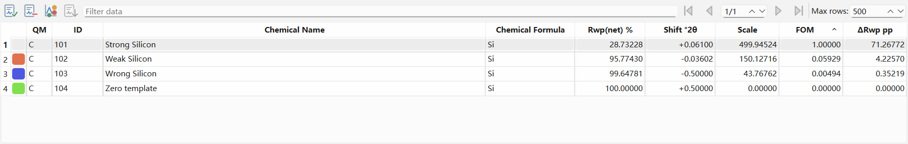

### 1. The `Results List` Dock

| Feature / Column | Role and Usage |
| :--- | :--- |
| **Phase acceptance** | Select rows and choose **Entry > Accept Selected Entries** (`Ctrl+Return`), or the corresponding context action, to accept phases into the quantification panel. In PFSM mode, accepting a phase immediately recomputes the joint multiphase profile fit and updates candidate rankings against the residual profile. |
| **ID** | Database entry identifier (e.g., `9000101`). |
| **FOM** | Overall Figure of Merit score (sorted descending by default). |
| **Scale** | Fitted phase scale factor relative to the experimental pattern. |
| **Chemical Name / Mineral Name / Formula** | Phase identity and empirical/structural formula. |
| **Quality (`Q`)** | Crystallographic quality mark (`S` = Star, `I` = Indexed, `C` = Calculated, `B` = Blank/Low precision, etc.). |
| **Filter Box & Pagination** | Type any text in the filter bar to filter candidate rows before pagination, and use **Previous Page** / **Next Page** (navigation buttons in the results toolbar) to browse large result sets. |

### 2. Live Joint Trial Preview on the Central Plot (PFSM)

When you highlight any candidate row in the **Results List** after a PFSM search, the central diffraction plot immediately renders a **live Joint Trial preview**:
- The calculated profile of all **already accepted phases plus the highlighted candidate phase** is drawn over the experimental pattern;
- The **difference curve** ($I_{\text{obs}} - I_{\text{calc}}$) updates at the bottom of the plot so you can see immediately whether the candidate explains the remaining residual peaks;
- Reference reflection stick bars for the candidate are displayed below the pattern.

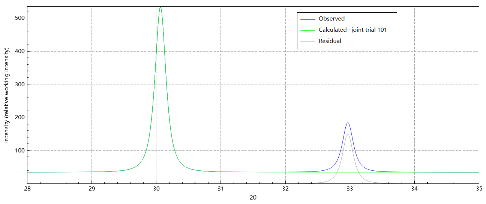

### 3. Reflection-by-Reflection Alignment (`Compare` Dock)

Open the **Compare** dock (**Window > Compare**) to inspect numerical reflection matching between the experimental peak table and the currently selected candidate (plus any accepted phases).

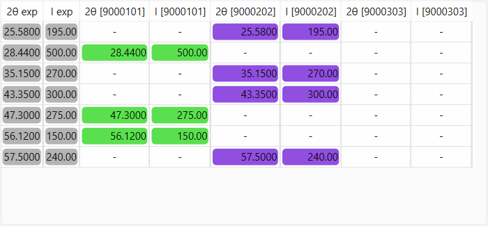

Each row in the **Compare** dock represents an experimental reflection ($2\theta$, $d$, $I$) alongside the closest matched reflection ($2\theta_{\text{ref}}$, $d_{\text{ref}}$, $I_{\text{ref}}$, $\Delta 2\theta$) from the highlighted candidate card and each accepted phase. Clicking rows in the **Compare** table highlights the corresponding reflection positions directly on the central plot.

---

## Quantification

Every phase you accept from the **Results List** is added to the **Quantification** panel (**Window > Quantitative analysis**).

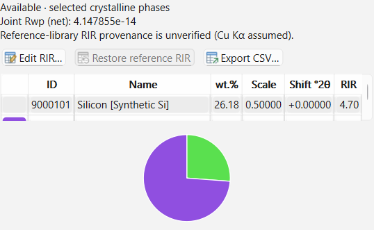

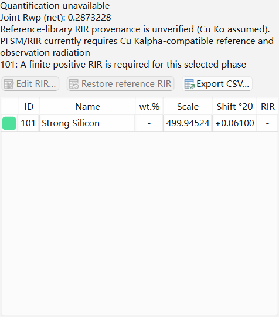

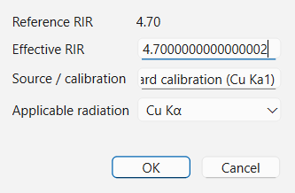

### How Reference Intensity Ratio (RIR) Quantification Works

QualPF computes semi-quantitative crystalline weight fractions ($W_k$, in $\text{Wt.\%}$) for all accepted phases $k = 1, \dots, M$ using the normalized **Reference Intensity Ratio ($I/I_c$)** method:

$$W_k = \frac{A_k}{\sum_j A_j}\times 100\%, \qquad
A_k = \frac{s_k M_k}{\mathrm{RIR}_k}$$

Here $s_k$ is the accepted joint PFSM scale and $M_k$ is the maximum intensity
of the **full frozen reference card**, before window restriction, expansion or
sampling. Omitting $M_k$ gives incorrect fractions for differently normalized
cards. Classical quantification retains its separate card-intensity/scale
convention.

PFSM/RIR currently requires Cu Kalpha-compatible radiation, a finite positive RIR
and reference maximum for every accepted phase, verified joint-fit diagnostics
and identifiable nonzero templates. A positive RIR alone is insufficient.
Percentages are normalized over selected crystalline phases; unidentified and
amorphous material are excluded. Reference-library RIR source conditions are
unverified and preferred orientation, microabsorption and model mismatch can bias
these semi-quantitative estimates. FOM is not a confidence probability.

> **Important:** > **RIR Completeness Rule**:
> Because normalized RIR quantification requires dividing every accepted phase's scale factor by its $\text{RIR}_k$, **every accepted phase must have a valid positive RIR value ($\text{RIR}_k > 0$)** for weight percentages (`Wt.%`) and the pie chart to be computed. If any accepted phase is missing an RIR value in the database, the **Quantification** panel clearly indicates the `Missing RIR` status with the affected phase named. In PFSM you can supply a calibrated value through **Edit RIR...**; Classical mode does not expose RIR overrides.

### `Quantification` Panel Controls and Columns

| Control / Column | Role and Behavior |
| :--- | :--- |
| **Accepted Phase Table** | Lists `ID`, `Name` and `wt.%`; PFSM additionally shows `Scale`, `Shift °2θ` and `RIR`. RIR provenance is available in its tooltip and export/report. Unavailable values show a dash. |
| **Edit RIR...** | PFSM only. Opens the **Edit RIR** dialog for the selected phase so you can enter an experimentally calibrated or literature $\text{RIR}$ value (`> 0`) and record an optional **RIR source** note (for example, `Internal standard calibration (Cu Kα)`). |
| **Restore reference RIR** | Reverts a user-modified (`Revised`) RIR back to the original database `Reference RIR` value. |
| **Export CSV** | Exports the accepted phase quantification table (including phase IDs, names, formulas, scale factors, RIR values, RIR sources, and `Wt.%`) to a `.csv` file. |
| **Right-Click > Remove Phase** | Removes the selected accepted phase. PFSM jointly refits and reranks; Classical removal does not restore intensities already subtracted from its residual. |
| **Pie Chart Tab / View** | Displays a color-coded graphical breakdown of the normalized phase weight fractions (`Wt.%`). |

---

## Generating and Printing the Analysis Report (`Report` Dock)

Switch to the **Report** dock (**Window > Report**) to view a comprehensive, publication-ready summary of the current session.

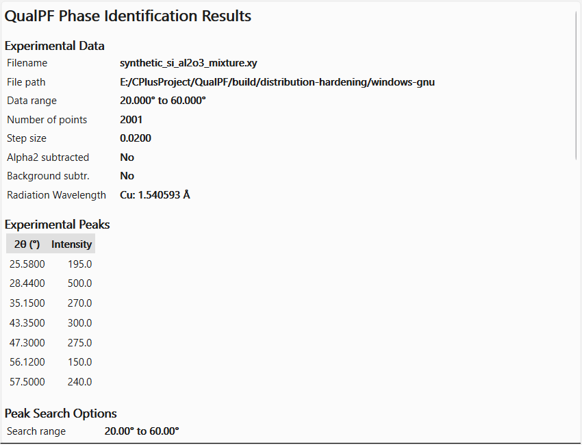

The **Report** document updates automatically as you accept phases or refine RIR values and includes:

1. **Pattern & Radiation Summary** — Source filename, angular calculation range, radiation kind, and $\lambda_1 / \lambda_2$ wavelengths.
2. **Data-Reduction & Peak Search Parameters** — Active angular interval, intensity threshold, sensitivity, and restraints summary.
3. **Search Results & Quantitative Breakdown** — Up to 100 current result cards with IDs, chemical/mineral names, formulas, FOM and scale, followed by the accepted-phase quantification table, active RIR values, provenance and normalized `Wt.%` when available.
4. **Experimental Peak List** — Extracted experimental $2\theta$ positions and intensities. Use the **Peaks** table or peak export for $d$-spacing and FWHM details, and **Compare** for reflection comparisons.

Source paths, card metadata and restraint text retain their literal characters
in the report and printed PDF, including angle brackets and ampersands.

To print the report or save it as a PDF file, select **File > Print...** (`Ctrl+P`), choose **Report** in the content dialog, then choose the printer/PDF destination.
