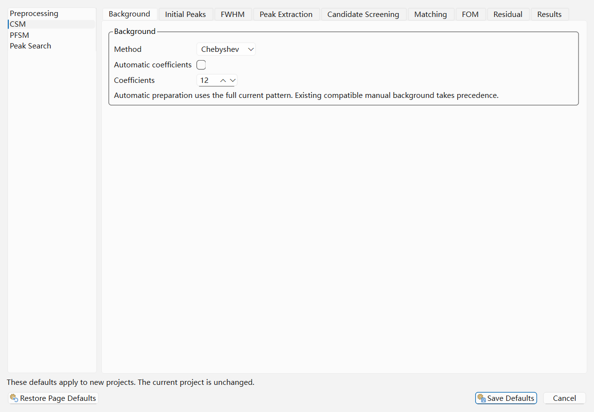
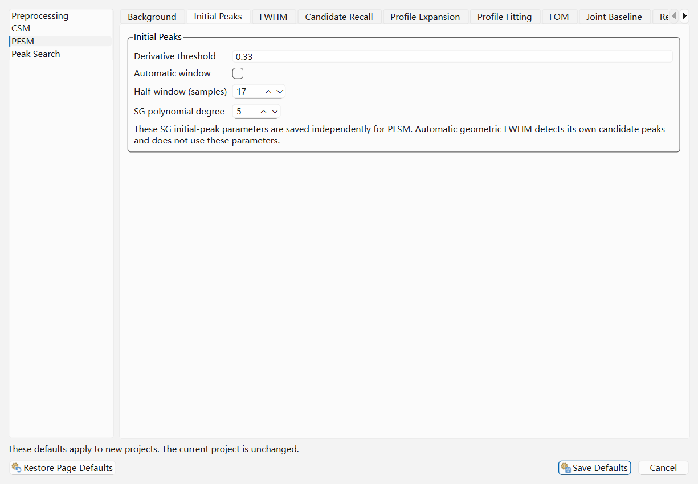
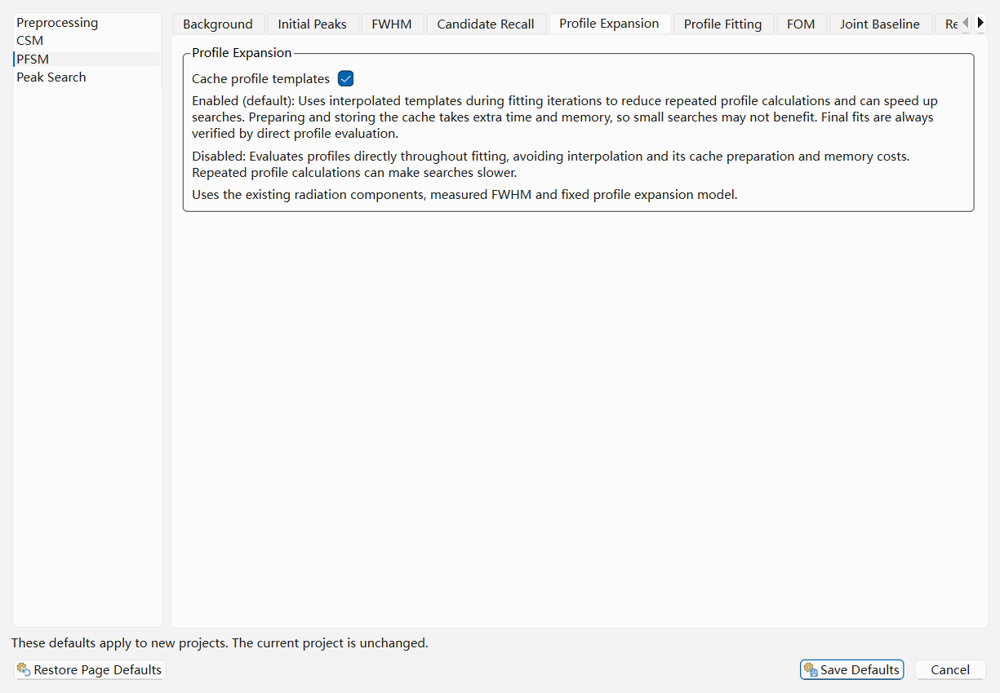
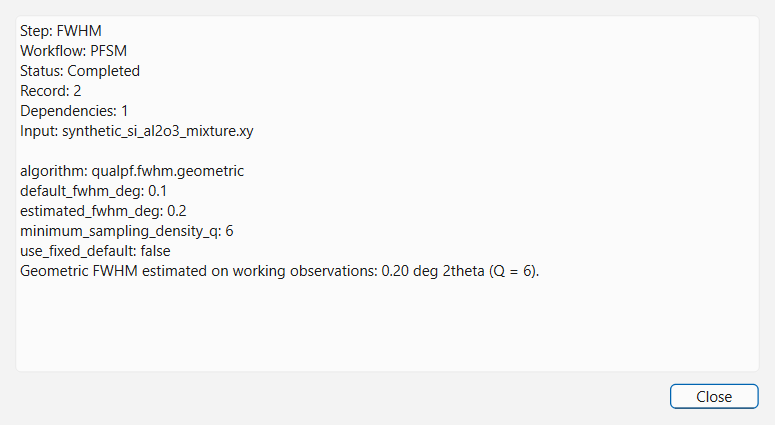

# Workflow Settings and Project History

QualPF separates **persistent default parameters for new projects** from **per-project runtime parameters and execution history**. Understanding how these three configuration surfaces interact ensures reproducible analyses across single patterns and large laboratory batches.

---

## The Three Configuration Surfaces in QualPF

| Surface | Where to Open | Scope | Purpose |
| :--- | :--- | :--- | :--- |
| **1. `Setting` Menu (`Setting — Defaults for New Projects`)** | **Setting > Preprocessing...** **Setting > CSM...** **Setting > PFSM...** **Setting > Peak Search...** | Persistent user preferences (applies to **future projects** created via **Import Pattern**) | Defines the baseline parameter profile that every newly imported pattern inherits. Does **not** overwrite or invalidate an already open project. |
| **2. Project `Options` Dialogs** | **Preprocessing > ... Options...** **S&M > CSM Options...** **S&M > PFSM Options...** | Active project only (saved inside `.qpf`) | Edits the current project. Data-reduction dialogs preview/execute their step; search options configure later runs. Affected dependent results require confirmation before removal. Global defaults are unchanged. |
| **3. `Workflow — Current Project` Dock** | **View > Workflow — Current Project** (dock panel) | Active project execution log (saved inside `.qpf`) | Records every manual and automatic workflow step executed on the current project, allows you to inspect exact runtime parameters, and supports non-destructive rollback (**Undo Selected**). |

---

## Configuring Defaults for New Projects (`Setting` Menu)

Choosing any item under the **Setting** menu opens the **Setting — Defaults for New Projects** dialog with that workflow selected in the left navigation list.

The left sidebar contains four workflow profiles:
1. **Preprocessing** — Default parameters when you run manual data-reduction actions from the **Preprocessing** menu.
2. **CSM** — Default prerequisite and search parameters for the Classical Peak-List Search-Match workflow.
3. **PFSM** — Default prerequisite, profile-fitting, and candidate-recall parameters for the Profile-Fitting Search-Match workflow.
4. **Peak Search** — Default prerequisite and extraction parameters for standalone Peak Search workflows.

> **Note:** > Why do **Preprocessing**, **CSM**, **PFSM**, and **Peak Search** each have their own tabs for modules like **Background**, **Initial Peaks**, and **FWHM**?
> Because different analysis routes benefit from different defaults! For example, **PFSM** defaults to **Geometric FWHM** ($Q = 6$) and does not require a classical peak table, whereas **CSM** and **Peak Search** default to **Gaussian fit (Classical)** FWHM and extract a discrete peak list.

### Example Views of `Setting — Defaults for New Projects`

---

## Complete Parameter Reference: `Setting — Defaults for New Projects`

### 1. Shared Data-Reduction Module Tabs

The labels and ranges below describe **Setting — Defaults for New Projects**.
Individual project dialogs can expose a narrower range or a different presentation.
Defaults listed here are factory values; saved user defaults can differ.

| Tab / parameter | Factory value | Editor range / behavior |
| :--- | :--- | :--- |
| **Range — Use saved range for explicit Range command** | Off | Preprocessing only. Bounds default to `0`–`180`°; cropping is always explicit, never an automatic search prerequisite. |
| **Background — Method** | `Chebyshev` | `Chebyshev`, `Polynomial`, `Cosine`, `Spline`, `Bezier`, `Bruckner`, `None`. |
| **Automatic coefficients / Coefficients** | On / `6` | Manual coefficient field `0`–`36`; the selected method also validates usable counts. |
| **Bruckner iterations / half-window (samples)** | `5` / `50` | Defaults editors allow `0`–`100000`, but the estimator accepts at most `10000` iterations. Automatic preparation uses the full pattern; compatible manual background can be reused. |
| **Initial Peaks — Derivative threshold** | `0.1` | `0`–`200`. Used by Gaussian SG preparation; geometric FWHM detects its own candidates. |
| **Automatic window / Half-window (samples)** | On / `11` | Manual half-window `2`–`100`; full window is `2m+1` samples. |
| **SG polynomial degree** | `9` | `3`–`20`; effective degree is capped by the window. |
| **FWHM — Automatic method** | Gaussian, except PFSM | Gaussian or Geometric outside PFSM. Automatic PFSM width is geometric, with internal candidate detection. |
| **Use fixed width / Fixed FWHM** | Off / `0.1`° | A checked fixed width bypasses estimation. Positive width up to `180`°; automatic failure does not silently substitute it. |
| **Minimum samples per FWHM (Q)** | `6` | `2`–`8` for geometric estimation. |
| **Smoothing — Method** | `Savitzky–Golay` | Savitzky–Golay or Averaging; Preprocessing only, executed explicitly. |
| **Half-window / Polynomial degree** | `4` / `5` | Defaults editors: half-window `1`–`100000`, degree `0`–`20`. SG execution requires half-window at most `100`, degree at most `2m` and at least `2m+1` samples; invalid combinations fail rather than cap the degree. The individual project dialog has narrower controls. |
| **Kα2** | Informational page | Explicit stripping operation; no enable-default checkbox or adjustable algorithm parameters. Source radiation and stripping history must be known. |

### 2. Peak Search and CSM Module Tabs

| Workflow / parameter | Factory value | Meaning / editor range |
| :--- | :--- | :--- |
| **Peak Extraction — Derivative threshold** | `0.1` | `0`–`1000000`; formal detection's own threshold. |
| **Automatic window / Half-window / SG degree** | On / `11` / `9` | Manual window `1`–`100`; degree `3`–`20`. Physical FWHM calibrates the fitting/search width. |
| **Minimum / Maximum angle** | `0` / `180`° | Applied to peak selection; the pattern's actual domain still bounds usable data. |
| **Minimum relative height (%)** | `1.5` | `0`–`100`. |
| **Maximum peaks (−1: all)** | `-1` | Editor `-1`–`100000`; use `-1` for no count cap. |
| **Retain peaks outside this range** | Off | Preserves outside-range peaks when combining a new selection. These selection controls are in CSM's Peak Extraction tab and standalone Peak Search's Peak Selection tab. |
| **CSM — Use strongest-reflection screening** | On | All first up to three stored strong-line d-spacings must pass, not just one. See the [screening rules](search-match/search-match.md#how-check-strongest-peaks-actually-screens-cards). |
| **Exclude deleted entries** | On | Filters deleted cards. The current-project **Check deleted cards** checkbox represents this exclusion check. |
| **Maximum entries** | `3000` | Positive integer; Candidate Screening tab. |
| **Automatic tolerance / Tolerance** | On / saved manual `0.08`° | Auto uses the current peak-width rule, not the saved manual value. Defaults editor `0`–`180`°; execution requires a positive tolerance. The project manual editor permits `0.01`–`0.50`°. |
| **Position / Intensity / Phase weight** | `0.5` each | `0`–`1` in FOM tab. The phase value controls coverage weighting and the divisor `round(10-9p)`; see [CSM options](search-match/search-match.md#parameter-reference-csm-options-dialog). |
| **Minimum FOM** | `0.35` | `0`–`1`. A ranking score, not a probability of correct identification. |
| **Subtract accepted phase residual** | On | Residual tab. Removing a Classical phase does not restore previously subtracted residual intensities. |

### 3. PFSM Module Tabs

| Tab / parameter | Factory value | Meaning / validation |
| :--- | :--- | :--- |
| **Candidate Recall — Enable candidate recall** | On | Approximate prescreening before formal fitting. It can omit phases; inspect scientific evidence and compare with recall disabled when needed. |
| **On resource limit** | Bounded integral recall | Selects bounded integral recall or full-pool formal fitting when the standard v2 resource route cannot be used. |
| **Recall candidates / Local shortlist / Protected per channel** | `500` / `20` / `5` | Positive integers; protection ≤ local shortlist ≤ recall target. Standard v2 alternates original/residual channels and retains cutoff ties and protection. Local shortlist is not a count per angular window. |
| **Review limit / Formal limit** | `80` / `80` | Each must be at least the local shortlist. Exceeding either threshold selects full-pool fitting; these are not fit-count caps. Bounded integral recall instead uses fixed channel budgets. |
| **Profile Expansion — Cache profile templates** | On | Interpolation during fitting can save repeated calculations but costs preparation time/memory. Final fits are checked by direct evaluation. The model is fixed Intermediate Lorentzian. |
| **Profile Fitting — Lower / Upper shift** | `-0.5` / `0.5`° | Ordered finite bounds; defaults editor `-180`–`180`°. The project dialog accepts finite ordered values rather than a ±5° restriction. |
| **Weights** | Automatic from attested noise | Uses compatible declared noise when available; otherwise equal weights. Current text/CIF importers do not attest Poisson statistics. |
| **Workers (0: automatic)** | `0` | Nonnegative integer; actual execution respects available resources. |
| **FOM / Joint Baseline** | Informational | Fixed scoring and nonnegative joint-fit rules; no extra solver controls. |
| **Results — Minimum relative FOM (display)** | `0` | `0`–`1`; changes the displayed candidate subset, not the frozen fit evidence. |

### Dialog Action Buttons (`Setting — Defaults for New Projects`)

- **Restore Page Defaults**: Resets **only the currently visible workflow/tab page** back to factory defaults without discarding changes made on other tabs.
- **Cancel**: Closes the dialog and discards any unsaved edits.
- **Save Defaults**: Persists all modified workflow defaults to user preferences for future projects.

---

## Inspect and Undo

While you work on an open diffraction pattern, the **Workflow — Current Project** dock records an ordered provenance trail of every executed step—whether triggered manually by you (e.g., **Preprocessing > Generate Background**) or executed automatically as a prerequisite of **Run PFSM** or **Run CSM**.

### Columns in the `Workflow — Current Project` Table

| Column | Meaning |
| :--- | :--- |
| **Step** | Name of the recorded stage. |
| **Source** | Manual preprocessing or Automatic plus the owning workflow (CSM, PFSM or Peak Search). |
| **Status** | Not started, Running, Completed, Fixed configuration, Failed, Cancelled or Invalidated, as applicable. |

The status text below the table reports the current or most recent attempt.

### Viewing Step Details (`Details`)

Select a row and click **Details** to open the **Workflow step details** dialog.

This read-only inspector displays:
- The step name, workflow, status, record ID and input source; manual/automatic origin is shown in the dock's **Source** column;
- Upstream step IDs (`Dependencies`) whose outputs fed into this step;
- The recorded actual parameters as flattened name/value fields, including the relevant preprocessing or search configuration and resolved evidence.

### Rolling Back Project Steps (`Undo Selected`)

To undo a search while retaining its prerequisites, select its Search step.
To undo preparation and its dependent search, select the earlier preparation step:

1. Highlight the step you wish to roll back in the **Workflow — Current Project** table.
2. Click **Undo Selected**.
3. Review any dependency confirmation. QualPF atomically restores the retained pre-step snapshot and removes the affected results.

Undo requires a completed or fixed-configuration step with a checkpoint retained
in this session. It restores affected outputs through the dependency closure;
current project settings and unrelated presentation remain current, so it is not
a wholesale return to all pre-step options. QPF saves records and parameters,
but not undo checkpoints. After reopening, inspect records and explicitly
recompute or reimport when rollback is unavailable.
